# Database Schema Documentation

> **Generated file — do not hand-edit.** Run `pnpm run docs:schema`
> (`scripts/generate-schema-docs.mjs`) to regenerate this document from the
> `@Entity` decorators in `src/**/*.entity.ts` after adding or changing an
> entity. (#2046)

## Overview

84 tables, derived from 88 entity files under `backend/src`.

For the domain-level narrative behind these relationships (e.g. what a
landlord/tenant/agent role on `rent_agreements` actually means), see
[SCHEMA_RELATIONSHIPS.md](./SCHEMA_RELATIONSHIPS.md), which is hand-written
and complementary to this generated reference rather than a duplicate of it.

## Entity Relationship Diagram

```mermaid
erDiagram
  Arbiter }o--|| User : ManyToOne
  AuditLog }o--|| User : ManyToOne
  Booking }o--|| Property : ManyToOne
  Booking }o--|| User : ManyToOne
  Dispute }o--|| RentAgreement : ManyToOne
  Dispute }o--|| User : ManyToOne
  DisputeComment }o--|| Dispute : ManyToOne
  DisputeComment }o--|| User : ManyToOne
  DisputeEvidence }o--|| Dispute : ManyToOne
  DisputeEvidence }o--|| User : ManyToOne
  DisputeVote }o--|| Arbiter : ManyToOne
  DisputeVote }o--|| Dispute : ManyToOne
  DocumentVersion }o--|| Document : ManyToOne
  EscrowCondition }o--|| StellarEscrow : ManyToOne
  EscrowSignature }o--|| StellarEscrow : ManyToOne
  Favorite }o--|| FavoriteCollection : ManyToOne
  Favorite }o--|| Property : ManyToOne
  Favorite }o--|| User : ManyToOne
  FavoriteCollection }o--|| User : ManyToOne
  LoginActivity }o--|| User : ManyToOne
  MfaDevice }o--|| User : ManyToOne
  NFTTransfer }o--|| RentObligationNft : ManyToOne
  Notification }o--|| User : ManyToOne
  Payment }o--|| RentAgreement : ManyToOne
  ProfileMetadata }o--|| User : ManyToOne
  Property }o--|| User : ManyToOne
  PropertyAmenity }o--|| Property : ManyToOne
  PropertyAvailability }o--|| Property : ManyToOne
  PropertyImage }o--|| Property : ManyToOne
  PropertyTourEngagement }o--|| Property : ManyToOne
  Referral }o--|| User : ManyToOne
  RentObligationNft }o--|| RentAgreement : ManyToOne
  RentalUnit }o--|| Property : ManyToOne
  SavedSearch }o--|| User : ManyToOne
  SettlementOffer }o--|| Dispute : ManyToOne
  StellarAccount }o--|| User : ManyToOne
  StellarEscrow ||--|| StellarAccount : OneToOne
  StellarEscrow }o--|| StellarAccount : ManyToOne
  StellarTransaction }o--|| StellarAccount : ManyToOne
  UserNotificationPreference ||--|| User : OneToOne
  WebhookDelivery }o--|| WebhookEndpoint : ManyToOne
  AdminPermissionDelegation
  AgentTransaction
  AgreementTemplate
  AnchorTransaction
  ApiKeyRotationHistory
  ApiKey
  AuthMetric
  DeadLetterJob
  DisputeEvent
  FeatureFlag
  Feedback
  FileMetadata
  FraudAlertEntity
  FraudThresholds
  GuestReview
  HostReview
  IndexedTransaction
  Kyc
  MaintenanceRequest
  Vendor
  MessageRead
  OAuthAccount
  OAuthState
  PaymentMethod
  PaymentSchedule
  PerformanceAlert
  Permission
  PropertyInquiry
  PropertyListingDraft
  RentPayment
  RentReminder
  ReviewPrompt
  Review
  Role
  SecurityEvent
  StellarPayment
  SubletBooking
  SubletRequest
  SupportedCurrency
  TemplateClause
  TenantScreeningConsent
  TenantScreeningReport
  TenantScreeningRequest
  TerminationReconciliation
  ThreatEvent
  UserPreferences
```

## Table of Contents

- [`admin_permission_delegations`](#adminpermissiondelegations)
- [`agent_transactions`](#agenttransactions)
- [`agreement_templates`](#agreementtemplates)
- [`anchor_transactions`](#anchortransactions)
- [`api_key_rotation_history`](#apikeyrotationhistory)
- [`api_keys`](#apikeys)
- [`arbiters`](#arbiters)
- [`audit_logs`](#auditlogs)
- [`auth_metrics`](#authmetrics)
- [`bookings`](#bookings)
- [`dead_letter_jobs`](#deadletterjobs)
- [`dispute_comments`](#disputecomments)
- [`dispute_events`](#disputeevents)
- [`dispute_evidence`](#disputeevidence)
- [`dispute_settlement_offers`](#disputesettlementoffers)
- [`dispute_votes`](#disputevotes)
- [`disputes`](#disputes)
- [`document_versions`](#documentversions)
- [`documents`](#documents)
- [`escrow_conditions`](#escrowconditions)
- [`escrow_signatures`](#escrowsignatures)
- [`favorite_collections`](#favoritecollections)
- [`favorites`](#favorites)
- [`feature_flags`](#featureflags)
- [`feedback`](#feedback)
- [`file_metadata`](#filemetadata)
- [`fraud_alerts`](#fraudalerts)
- [`fraud_thresholds`](#fraudthresholds)
- [`guest_reviews`](#guestreviews)
- [`host_reviews`](#hostreviews)
- [`indexed_transactions`](#indexedtransactions)
- [`kyc`](#kyc)
- [`login_activities`](#loginactivities)
- [`maintenance_requests`](#maintenancerequests)
- [`maintenance_vendors`](#maintenancevendors)
- [`message_read`](#messageread)
- [`mfa_devices`](#mfadevices)
- [`nft_transfers`](#nfttransfers)
- [`notifications`](#notifications)
- [`oauth_accounts`](#oauthaccounts)
- [`oauth_states`](#oauthstates)
- [`payment_methods`](#paymentmethods)
- [`payment_schedules`](#paymentschedules)
- [`payments`](#payments)
- [`performance_alerts`](#performancealerts)
- [`permissions`](#permissions)
- [`profile_metadata`](#profilemetadata)
- [`properties`](#properties)
- [`property_amenities`](#propertyamenities)
- [`property_availability`](#propertyavailability)
- [`property_images`](#propertyimages)
- [`property_inquiries`](#propertyinquiries)
- [`property_listing_drafts`](#propertylistingdrafts)
- [`property_tour_engagements`](#propertytourengagements)
- [`referrals`](#referrals)
- [`rent_agreements`](#rentagreements)
- [`rent_obligation_nfts`](#rentobligationnfts)
- [`rent_payments`](#rentpayments)
- [`rent_payments`](#rentpayments)
- [`rent_reminders`](#rentreminders)
- [`rental_units`](#rentalunits)
- [`review_prompts`](#reviewprompts)
- [`reviews`](#reviews)
- [`roles`](#roles)
- [`saved_searches`](#savedsearches)
- [`security_events`](#securityevents)
- [`stellar_accounts`](#stellaraccounts)
- [`stellar_escrows`](#stellarescrows)
- [`stellar_payments`](#stellarpayments)
- [`stellar_transactions`](#stellartransactions)
- [`sublet_bookings`](#subletbookings)
- [`sublet_requests`](#subletrequests)
- [`supported_currencies`](#supportedcurrencies)
- [`template_clauses`](#templateclauses)
- [`tenant_screening_consents`](#tenantscreeningconsents)
- [`tenant_screening_reports`](#tenantscreeningreports)
- [`tenant_screening_requests`](#tenantscreeningrequests)
- [`termination_reconciliations`](#terminationreconciliations)
- [`threat_events`](#threatevents)
- [`user_ai_preferences`](#useraipreferences)
- [`user_notification_preferences`](#usernotificationpreferences)
- [`users`](#users)
- [`webhook_deliveries`](#webhookdeliveries)
- [`webhook_endpoints`](#webhookendpoints)

## Tables

#### `admin_permission_delegations`

Entity class: `AdminPermissionDelegation` (backend/src/modules/security/entities/admin-permission-delegation.entity.ts)

| Column | Type | Notes |
| --- | --- | --- |
| `id` | uuid | PK |
| `grantor_id` | uuid | not null |
| `grantee_id` | uuid | not null |
| `resource` | varchar | not null |
| `action` | varchar | not null |
| `created_at` | timestamp | not null |

**Indexes:** `grantee_id, resource, action` (unique)

#### `agent_transactions`

Entity class: `AgentTransaction` (backend/src/modules/stellar/entities/agent-transaction.entity.ts)

| Column | Type | Notes |
| --- | --- | --- |
| `agent_address` | inferred | not null |
| `parties` | inferred | not null |
| `completed` | inferred | not null default: false |
| `blockchain_hash` | varchar | - |
| `created_at` | timestamp | not null |
| `updated_at` | timestamp | not null |

#### `agreement_templates`

Entity class: `AgreementTemplate` (backend/src/modules/agreements/entities/agreement-template.entity.ts)

| Column | Type | Notes |
| --- | --- | --- |
| `id` | uuid | PK |
| `name` | inferred | not null |
| `base_content` | text | not null |
| `jurisdiction` | inferred | not null |
| `is_active` | inferred | not null default: true |
| `created_at` | timestamp | not null |
| `updated_at` | timestamp | not null |

#### `anchor_transactions`

Entity class: `AnchorTransaction` (backend/src/modules/transactions/entities/anchor-transaction.entity.ts)

| Column | Type | Notes |
| --- | --- | --- |
| `id` | uuid | PK |
| `anchor_transaction_id` | inferred | - |
| `type` | enum | not null |
| `status` | enum | not null default: AnchorTransactionStatus.PENDING |
| `amount` | decimal | not null |
| `currency` | inferred | not null |
| `wallet_address` | inferred | not null |
| `payment_method` | inferred | - |
| `destination` | text | - |
| `stellar_transaction_id` | inferred | indexed |
| `memo` | text | - |
| `metadata` | jsonb | - |
| `created_at` | timestamp | not null |
| `updated_at` | timestamp | not null |

**Indexes:** `wallet_address, status`, `anchor_transaction_id`, `stellar_transaction_id`

#### `api_key_rotation_history`

Entity class: `ApiKeyRotationHistory` (backend/src/modules/developer/entities/api-key-rotation-history.entity.ts)

| Column | Type | Notes |
| --- | --- | --- |
| `id` | uuid | PK |
| `api_key_id` | uuid | not null |
| `user_id` | uuid | not null |
| `old_key_hash` | varchar | not null |
| `new_key_hash` | varchar | not null |
| `old_key_prefix` | varchar | - |
| `new_key_prefix` | varchar | - |
| `rotated_at` | timestamp | not null |

#### `api_keys`

Entity class: `ApiKey` (backend/src/modules/developer/entities/api-key.entity.ts)

| Column | Type | Notes |
| --- | --- | --- |
| `id` | uuid | PK |
| `user_id` | uuid | not null |
| `name` | varchar | not null |
| `description` | varchar | - |
| `key_hash` | varchar | not null |
| `key_prefix` | varchar | - |
| `permissions` | inferred | not null default: '' |
| `last_used_at` | varchar | - |
| `expires_at` | varchar | - |
| `rotated_at` | varchar | - |
| `previous_key_hash` | varchar | - |
| `is_rotated` | boolean | not null default: false |
| `status` | varchar | not null default: ApiKeyStatus.ACTIVE |
| `created_at` | timestamp | not null |
| `updated_at` | timestamp | not null |

#### `arbiters`

Entity class: `Arbiter` (backend/src/modules/disputes/entities/arbiter.entity.ts)

| Column | Type | Notes |
| --- | --- | --- |
| `id` | uuid | PK |
| `stellar_address` | varchar | not null |
| `user_id` | int | - |
| `active` | inferred | not null default: true |
| `blockchain_added_at` | bigint | - |
| `transaction_hash` | varchar | - |
| `total_votes` | inferred | not null default: 0 |
| `total_disputes_resolved` | inferred | not null default: 0 |
| `reputation_score` | decimal | not null default: 0 |
| `successful_resolutions` | inferred | not null default: 0 |
| `metadata` | jsonb | - |
| `created_at` | timestamp | not null |
| `updated_at` | timestamp | not null |

**Relations:** ManyToOne → `User` (via `user_id`)

#### `audit_logs`

Entity class: `AuditLog` (backend/src/modules/audit/entities/audit-log.entity.ts)

| Column | Type | Notes |
| --- | --- | --- |
| `id` | uuid | PK |
| `action` | varchar | not null |
| `entity_type` | varchar | - |
| `entity_id` | varchar | - |
| `old_values` | jsonb | - |
| `new_values` | jsonb | - |
| `performed_by` | uuid | - |
| `performed_at` | timestamptz | not null |
| `ip_address` | inet | - |
| `user_agent` | text | - |
| `status` | varchar | - |
| `error_message` | text | - |
| `level` | varchar | not null default: 'INFO' |
| `metadata` | jsonb | - |

**Indexes:** `entity_type, entity_id`, `performed_by`, `performed_at`

**Relations:** ManyToOne → `User` (via `performed_by`)

#### `auth_metrics`

Entity class: `AuthMetric` (backend/src/modules/auth/entities/auth-metric.entity.ts)

| Column | Type | Notes |
| --- | --- | --- |
| `id` | uuid | PK |
| `auth_method` | enum | - default: AuthMethod.STELLAR |
| `success` | boolean | not null |
| `duration` | int | not null |
| `ip_address` | varchar | - |
| `user_agent` | text | - |
| `error_message` | text | - |
| `timestamp` | timestamp | not null |

**Indexes:** `timestamp`, `auth_method`, `success`

#### `bookings`

Entity class: `Booking` (backend/src/modules/bookings/entities/booking.entity.ts)

| Column | Type | Notes |
| --- | --- | --- |
| `id` | uuid | PK |
| `property_id` | uuid | indexed, not null |
| `guest_id` | uuid | indexed, not null |
| `check_in_date` | date | not null |
| `check_out_date` | date | not null |
| `guests` | int | not null default: 1 |
| `special_requests` | text | - |
| `payment_method` | enum | not null default: BookingPaymentMethod.CARD |
| `total_amount` | decimal | not null |
| `currency` | varchar | not null default: 'USD' |
| `status` | enum | indexed, not null default: BookingStatus.PENDING |
| `created_at` | timestamp | not null |
| `updated_at` | timestamp | not null |

**Indexes:** `property_id`, `guest_id`, `status`

**Relations:** ManyToOne → `Property` (via `property_id`), ManyToOne → `User` (via `guest_id`)

#### `dead_letter_jobs`

Entity class: `DeadLetterJob` (backend/src/modules/queues/entities/dead-letter-job.entity.ts)

| Column | Type | Notes |
| --- | --- | --- |
| `id` | uuid | PK |
| `queue_name` | inferred | not null |
| `job_name` | inferred | not null default: '__default__' |
| `original_job_id` | inferred | - |
| `payload` | jsonb | not null |
| `options` | jsonb | - |
| `error` | text | - |
| `stacktrace` | text | - |
| `attempt_count` | int | not null default: 0 |
| `recovery_attempts` | int | not null default: 0 |
| `status` | enum | not null default: DeadLetterJobStatus.PENDING |
| `resolved_at` | timestamp | - |
| `created_at` | timestamp | not null |
| `updated_at` | timestamp | not null |

**Indexes:** `queue_name, status`

#### `dispute_comments`

Entity class: `DisputeComment` (backend/src/modules/disputes/entities/dispute-comment.entity.ts)

| Column | Type | Notes |
| --- | --- | --- |
| `id` | uuid | PK |
| `dispute_id` | inferred | not null |
| `user_id` | uuid | not null |
| `content` | text | not null |
| `is_internal` | inferred | not null default: false |
| `created_at` | timestamp | not null |
| `updated_at` | timestamp | not null |

**Relations:** ManyToOne → `Dispute` (via `dispute_id`), ManyToOne → `User` (via `user_id`)

#### `dispute_events`

Entity class: `DisputeEvent` (backend/src/modules/disputes/entities/dispute-event.entity.ts)

| Column | Type | Notes |
| --- | --- | --- |
| `id` | uuid | PK |
| `dispute_id` | varchar | not null |
| `event_type` | varchar | not null |
| `event_data` | jsonb | not null |
| `timestamp` | timestamp | not null |
| `triggered_by` | varchar | - |
| `transaction_hash` | varchar | - |
| `created_at` | timestamp | not null |

#### `dispute_evidence`

Entity class: `DisputeEvidence` (backend/src/modules/disputes/entities/dispute-evidence.entity.ts)

| Column | Type | Notes |
| --- | --- | --- |
| `id` | uuid | PK |
| `dispute_id` | inferred | not null |
| `uploaded_by` | uuid | not null |
| `file_url` | text | not null |
| `file_name` | text | not null |
| `file_type` | inferred | not null |
| `file_size` | inferred | not null |
| `description` | text | - |
| `scan_status` | enum | not null default: ScanStatus.PENDING |
| `processing_status` | enum | not null default: EvidenceProcessingStatus.NOT_APPLICABLE |
| `video_variants` | jsonb | - |
| `thumbnail_url` | text | - |
| `created_at` | timestamp | not null |

**Relations:** ManyToOne → `Dispute` (via `dispute_id`), ManyToOne → `User` (via `uploaded_by`)

#### `dispute_settlement_offers`

Entity class: `SettlementOffer` (backend/src/modules/disputes/entities/settlement-offer.entity.ts)

| Column | Type | Notes |
| --- | --- | --- |
| `id` | uuid | PK |
| `dispute_id` | int | not null |
| `proposed_by` | uuid | not null |
| `recipient_id` | uuid | not null |
| `amount` | decimal | - |
| `terms` | text | not null |
| `status` | varchar | not null default: SettlementOfferStatus.PENDING |
| `parent_offer_id` | uuid | - |
| `response_note` | text | - |
| `responded_at` | timestamp | - |
| `created_at` | timestamp | not null |
| `updated_at` | timestamp | not null |

**Relations:** ManyToOne → `Dispute` (via `dispute_id`)

#### `dispute_votes`

Entity class: `DisputeVote` (backend/src/modules/disputes/entities/dispute-vote.entity.ts)

| Column | Type | Notes |
| --- | --- | --- |
| `id` | uuid | PK |
| `dispute_id` | inferred | not null |
| `arbiter_id` | inferred | not null |
| `favor_landlord` | inferred | not null |
| `blockchain_voted_at` | bigint | - |
| `transaction_hash` | varchar | - |
| `comment` | text | - |
| `evidence` | text | - |
| `reasoning` | text | - |
| `vote_weight` | int | not null default: 1 |
| `created_at` | timestamp | not null |

**Relations:** ManyToOne → `Dispute` (via `dispute_id`), ManyToOne → `Arbiter` (via `arbiter_id`)

#### `disputes`

Entity class: `Dispute` (backend/src/modules/disputes/entities/dispute.entity.ts)

| Column | Type | Notes |
| --- | --- | --- |
| `id` | uuid | PK |
| `dispute_id` | inferred | not null |
| `agreement_id` | uuid | not null |
| `initiated_by` | uuid | not null |
| `dispute_type` | varchar | not null |
| `requested_amount` | decimal | - |
| `description` | text | not null |
| `status` | varchar | not null default: DisputeStatus.OPEN |
| `resolution` | text | - |
| `resolved_by` | uuid | - |
| `resolved_at` | timestamp | - |
| `metadata` | jsonb | - |
| `blockchain_agreement_id` | inferred | - |
| `details_hash` | inferred | - |
| `blockchain_raised_at` | bigint | - |
| `blockchain_resolved_at` | bigint | - |
| `votes_favor_landlord` | inferred | not null default: 0 |
| `votes_favor_tenant` | inferred | not null default: 0 |
| `blockchain_outcome` | inferred | - |
| `transaction_hash` | inferred | - |
| `blockchain_synced_at` | timestamp | - |
| `payment_id` | uuid | - |
| `rent_payment_id` | varchar | - |
| `disputed_payment_amount` | decimal | - |
| `payment_reference_number` | varchar | - |
| `payment_date` | inferred | - |
| `created_at` | timestamp | not null |
| `updated_at` | timestamp | not null |

**Relations:** ManyToOne → `RentAgreement` (via `agreement_id`), ManyToOne → `User` (via `initiated_by`), ManyToOne → `User` (via `resolved_by`)

#### `document_versions`

Entity class: `DocumentVersion` (backend/src/modules/documents/entities/document-version.entity.ts)

| Column | Type | Notes |
| --- | --- | --- |
| `id` | uuid | PK |
| `document_id` | uuid | not null |
| `version` | int | not null |
| `storage_key` | varchar | not null |
| `mime_type` | varchar | - |
| `checksum` | varchar | not null |
| `uploaded_by` | uuid | not null |
| `change_note` | text | - |
| `created_at` | timestamp | not null |

**Relations:** ManyToOne → `Document` (via `document_id`)

#### `documents`

Entity class: `Document` (backend/src/modules/documents/document.entity.ts)

| Column | Type | Notes |
| --- | --- | --- |
| `id` | uuid | PK |
| `owner_id` | uuid | indexed, not null |
| `name` | varchar | not null |
| `description` | text | - |
| `status` | varchar | not null default: DocumentStatus.DRAFT |
| `storage_key` | varchar | not null |
| `mime_type` | varchar | - |
| `checksum` | varchar | not null |
| `current_version` | int | not null default: 1 |
| `signed_at` | timestamp | - |
| `signed_by` | uuid | - |
| `signed_checksum` | varchar | - |
| `created_at` | timestamp | not null |
| `updated_at` | timestamp | not null |
| `name` | inferred | not null |
| `type` | varchar | not null default: 'OTHER' |
| `status` | varchar | not null default: 'ACTIVE' |
| `category` | varchar | not null default: 'other' |
| `file_key` | inferred | not null |
| `file_size` | inferred | not null |
| `file_type` | inferred | not null |
| `property_id` | varchar | - |
| `tenant_id` | varchar | - |
| `owner_id` | inferred | not null |
| `description` | varchar | - |
| `shared_with` | inferred | - |
| `signatures` | inferred | - |
| `created_at` | timestamp | not null |
| `updated_at` | timestamp | not null |

**Indexes:** `owner_id`

#### `escrow_conditions`

Entity class: `EscrowCondition` (backend/src/modules/stellar/entities/escrow-condition.entity.ts)

| Column | Type | Notes |
| --- | --- | --- |
| `id` | uuid | PK |
| `escrow_id` | inferred | not null |
| `condition_type` | varchar | not null |
| `parameters` | jsonb | not null |
| `satisfied` | inferred | not null default: false |
| `satisfied_at` | timestamp | - |
| `required` | inferred | not null default: true |
| `description` | text | - |
| `validation_result` | jsonb | - |
| `created_at` | timestamp | not null |
| `updated_at` | timestamp | not null |

**Relations:** ManyToOne → `StellarEscrow` (via `escrow_id`)

#### `escrow_signatures`

Entity class: `EscrowSignature` (backend/src/modules/stellar/entities/escrow-signature.entity.ts)

| Column | Type | Notes |
| --- | --- | --- |
| `id` | uuid | PK |
| `escrow_id` | inferred | not null |
| `signer_address` | varchar | not null |
| `signature` | text | not null |
| `signed_at` | timestamp | not null |
| `is_valid` | inferred | not null default: true |
| `signature_type` | varchar | not null default: 'release' |
| `metadata` | jsonb | - |

**Relations:** ManyToOne → `StellarEscrow` (via `escrow_id`)

#### `favorite_collections`

Entity class: `FavoriteCollection` (backend/src/modules/favorites/entities/favorite-collection.entity.ts)

| Column | Type | Notes |
| --- | --- | --- |
| `id` | uuid | PK |
| `user_id` | uuid | not null |
| `name` | varchar | not null |
| `created_at` | timestamp | not null |
| `updated_at` | timestamp | not null |

**Relations:** ManyToOne → `User` (via `user_id`)

#### `favorites`

Entity class: `Favorite` (backend/src/modules/favorites/entities/favorite.entity.ts)

| Column | Type | Notes |
| --- | --- | --- |
| `id` | uuid | PK |
| `user_id` | uuid | not null |
| `property_id` | uuid | not null |
| `collection_id` | uuid | - |
| `created_at` | timestamp | not null |

**Relations:** ManyToOne → `FavoriteCollection` (via `collection_id`), ManyToOne → `User` (via `user_id`), ManyToOne → `Property` (via `property_id`)

#### `feature_flags`

Entity class: `FeatureFlag` (backend/src/modules/feature-flags/entities/feature-flag.entity.ts)

| Column | Type | Notes |
| --- | --- | --- |
| `id` | uuid | PK |
| `key` | varchar | not null |
| `description` | varchar | - |
| `enabled` | boolean | not null default: true |
| `rollout_percentage` | int | not null default: 100 |
| `metadata` | inferred | - |
| `created_at` | timestamp | not null |
| `updated_at` | timestamp | not null |

#### `feedback`

Entity class: `Feedback` (backend/src/modules/feedback/entities/feedback.entity.ts)

| Column | Type | Notes |
| --- | --- | --- |
| `id` | uuid | PK |
| `email` | varchar | - |
| `message` | text | not null |
| `type` | varchar | not null default: FeedbackType.GENERAL |
| `user_id` | uuid | - |
| `status` | varchar | not null default: FeedbackStatus.NEW |
| `reviewed_by` | uuid | - |
| `reviewed_at` | timestamp | - |
| `created_at` | timestamp | not null |

#### `file_metadata`

Entity class: `FileMetadata` (backend/src/modules/storage/file-metadata.entity.ts)

| Column | Type | Notes |
| --- | --- | --- |
| `id` | uuid | PK |
| `file_name` | inferred | not null |
| `file_size` | inferred | not null |
| `file_type` | inferred | not null |
| `s3_key` | inferred | not null |
| `owner_id` | inferred | not null |
| `scan_status` | enum | not null default: ScanStatus.PENDING |
| `created_at` | timestamp | not null |
| `updated_at` | timestamp | not null |

#### `fraud_alerts`

Entity class: `FraudAlertEntity` (backend/src/modules/fraud/entities/fraud-alert.entity.ts)

| Column | Type | Notes |
| --- | --- | --- |
| `id` | uuid | PK |
| `subject_type` | varchar | not null |
| `subject_id` | uuid | not null |
| `score` | int | not null |
| `decision` | varchar | not null |
| `reasons` | inferred | not null |
| `model_version` | varchar | not null |
| `features` | inferred | - |
| `status` | varchar | not null default: 'open' |
| `resolved_at` | timestamp | - |
| `created_at` | timestamp | not null |
| `updated_at` | timestamp | not null |

#### `fraud_thresholds`

Entity class: `FraudThresholds` (backend/src/modules/fraud/entities/fraud-thresholds.entity.ts)

| Column | Type | Notes |
| --- | --- | --- |
| `id` | uuid | PK |
| `key` | varchar | not null default: 'default' |
| `threshold_review` | int | not null |
| `threshold_block` | int | not null |
| `created_at` | timestamp | not null |
| `updated_at` | timestamp | not null |

#### `guest_reviews`

Entity class: `GuestReview` (backend/src/modules/reviews/entities/guest-review.entity.ts)

| Column | Type | Notes |
| --- | --- | --- |
| `id` | uuid | PK |
| `booking_id` | varchar | not null |
| `guest_id` | varchar | not null |
| `host_id` | varchar | not null |
| `cleanliness` | int | not null default: 5 |
| `communication` | int | not null default: 5 |
| `respect_for_rules` | int | not null default: 5 |
| `comment` | text | not null |
| `would_host_again` | boolean | not null default: false |
| `created_at` | timestamp | not null |
| `updated_at` | timestamp | not null |

**Indexes:** `booking_id, host_id` (unique), `guest_id`, `host_id`

#### `host_reviews`

Entity class: `HostReview` (backend/src/modules/reviews/entities/host-review.entity.ts)

| Column | Type | Notes |
| --- | --- | --- |
| `id` | uuid | PK |
| `booking_id` | varchar | not null |
| `guest_id` | varchar | not null |
| `host_id` | varchar | not null |
| `accuracy` | int | not null default: 5 |
| `cleanliness` | int | not null default: 5 |
| `check_in` | int | not null default: 5 |
| `communication` | int | not null default: 5 |
| `location` | int | not null default: 5 |
| `value` | int | not null default: 5 |
| `comment` | text | not null |
| `created_at` | timestamp | not null |
| `updated_at` | timestamp | not null |

**Indexes:** `booking_id, guest_id` (unique), `guest_id`, `host_id`

#### `indexed_transactions`

Entity class: `IndexedTransaction` (backend/src/modules/transactions/entities/indexed-transaction.entity.ts)

| Column | Type | Notes |
| --- | --- | --- |
| `id` | uuid | PK |
| `transaction_hash` | varchar | not null |
| `ledger` | integer | not null |
| `ledger_close_time` | inferred | not null |
| `successful` | boolean | not null |
| `transaction_type` | inferred | not null default: IndexedTransactionType.OTHER |
| `source_account` | varchar | not null |
| `destination_account` | varchar | - |
| `amount` | varchar | not null |
| `asset_code` | varchar | not null |
| `asset_issuer` | varchar | - |
| `fee` | varchar | not null |
| `memo` | text | - |
| `memo_type` | inferred | - |
| `agreement_id` | uuid | - |
| `property_id` | uuid | - |
| `payment_id` | uuid | - |
| `deposit_id` | uuid | - |
| `operations` | inferred | not null default: () => (process.env.DB_TYPE === 'sqlite' ? "'[]'" : "'[]'::jsonb") |
| `metadata` | inferred | not null default: () => (process.env.DB_TYPE === 'sqlite' ? "'{ |
| `indexed` | boolean | not null default: false |
| `indexed_at` | inferred | - |
| `created_at` | timestamp | not null |

#### `kyc`

Entity class: `Kyc` (backend/src/modules/kyc/kyc.entity.ts)

| Column | Type | Notes |
| --- | --- | --- |
| `id` | uuid | PK |
| `user_id` | uuid | indexed, not null |
| `encryption_version` | int | not null default: 1 |
| `status` | enum | not null default: KycStatus.PENDING |
| `provider_reference` | text | - |
| `reason` | text | - |
| `document_hash` | text | - |
| `document_purged_at` | timestamp | - |
| `created_at` | timestamp | not null |
| `updated_at` | timestamp | not null |

**Indexes:** `user_id`

#### `login_activities`

Entity class: `LoginActivity` (backend/src/modules/auth/entities/login-activity.entity.ts)

| Column | Type | Notes |
| --- | --- | --- |
| `id` | uuid | PK |
| `user_id` | uuid | indexed |
| `email` | varchar | - |
| `login_method` | inferred | not null default: LoginMethod.PASSWORD |
| `status` | inferred | not null |
| `ip_address` | varchar | - |
| `user_agent` | text | - |
| `country` | varchar | - |
| `city` | varchar | - |
| `device` | varchar | - |
| `browser` | varchar | - |
| `os` | varchar | - |
| `failure_reason` | varchar | - |
| `is_suspicious` | boolean | not null default: false |
| `anomaly_flags` | inferred | - |
| `metadata` | inferred | - |
| `created_at` | timestamp | not null |

**Indexes:** `user_id, created_at`, `ip_address, created_at`, `status, created_at`, `user_id`

**Relations:** ManyToOne → `User` (via `user_id`)

#### `maintenance_requests`

Entity class: `MaintenanceRequest` (backend/src/modules/maintenance/maintenance-request.entity.ts)

| Column | Type | Notes |
| --- | --- | --- |
| `id` | uuid | PK |
| `property_id` | inferred | not null |
| `tenant_id` | inferred | not null |
| `landlord_id` | inferred | not null |
| `category` | inferred | not null |
| `description` | inferred | not null |
| `priority` | inferred | not null default: 'MEDIUM' |
| `status` | enum | not null default: MaintenanceStatus.OPEN |
| `media_urls` | inferred | - |
| `vendor_id` | inferred | - |
| `estimated_cost` | inferred | - |
| `cost_notes` | inferred | - |
| `cost_approved_by` | inferred | - |
| `cost_approved_at` | timestamp | - |
| `cost_rejection_reason` | inferred | - |
| `payment_id` | inferred | - |
| `response_due_at` | timestamp | - |
| `resolution_due_at` | timestamp | - |
| `sla_escalation_tier` | enum | not null default: SlaEscalationTier.NONE |
| `created_at` | timestamp | not null |
| `updated_at` | timestamp | not null |

#### `maintenance_vendors`

Entity class: `Vendor` (backend/src/modules/maintenance/entities/vendor.entity.ts)

| Column | Type | Notes |
| --- | --- | --- |
| `id` | uuid | PK |
| `name` | inferred | not null |
| `email` | inferred | - |
| `phone` | inferred | - |
| `specialties` | inferred | - |
| `landlord_id` | inferred | - |
| `created_at` | timestamp | not null |
| `updated_at` | timestamp | not null |

#### `message_read`

Entity class: `MessageRead` (backend/src/modules/messaging/entities/message-read.entity.ts)

| Column | Type | Notes |
| --- | --- | --- |
| `id` | uuid | PK |
| `user_id` | inferred | not null |
| `chat_room_id` | inferred | not null |
| `read_at` | timestamp | not null |
| `updated_at` | timestamp | not null |

**Indexes:** `user_id, chat_room` (unique), `user_id`

#### `mfa_devices`

Entity class: `MfaDevice` (backend/src/modules/auth/entities/mfa-device.entity.ts)

| Column | Type | Notes |
| --- | --- | --- |
| `id` | uuid | PK |
| `user_id` | inferred | not null |
| `type` | enum | not null default: MfaDeviceType.TOTP |
| `status` | enum | not null default: MfaDeviceStatus.ACTIVE |
| `device_name` | varchar | - |
| `secret_key` | varchar | - |
| `backup_codes` | text | - |
| `last_used_at` | timestamp | - |
| `created_at` | timestamp | not null |
| `updated_at` | timestamp | not null |

**Relations:** ManyToOne → `User` (via `user_id`)

#### `nft_transfers`

Entity class: `NFTTransfer` (backend/src/modules/agreements/entities/nft-transfer.entity.ts)

| Column | Type | Notes |
| --- | --- | --- |
| `id` | uuid | PK |
| `token_id` | inferred | not null |
| `from_address` | inferred | not null |
| `to_address` | inferred | not null |
| `transaction_hash` | inferred | - |
| `transferred_at` | timestamp | not null |
| `created_at` | timestamp | not null |

**Relations:** ManyToOne → `RentObligationNft` (via `token_id`)

#### `notifications`

Entity class: `Notification` (backend/src/modules/notifications/entities/notification.entity.ts)

| Column | Type | Notes |
| --- | --- | --- |
| `id` | uuid | PK |
| `title` | varchar | not null |
| `message` | text | not null |
| `is_read` | boolean | not null default: false |
| `type` | varchar | - |
| `user_id` | uuid | not null |
| `created_at` | timestamp | not null |

**Relations:** ManyToOne → `User` (via `user_id`)

#### `oauth_accounts`

Entity class: `OAuthAccount` (backend/src/modules/auth/oauth/entities/oauth-account.entity.ts)

| Column | Type | Notes |
| --- | --- | --- |
| `id` | uuid | PK |
| `user_id` | uuid | not null |
| `provider` | enum | not null |
| `provider_user_id` | varchar | not null |
| `email` | varchar | not null |
| `linked_at` | timestamp | not null |

**Indexes:** `user_id, provider` (unique), `provider, provider_user_id` (unique)

#### `oauth_states`

Entity class: `OAuthState` (backend/src/modules/auth/oauth/entities/oauth-state.entity.ts)

| Column | Type | Notes |
| --- | --- | --- |
| `provider` | enum | not null |
| `redirect_uri` | varchar | not null |
| `user_id` | uuid | - |
| `expires_at` | timestamp | not null |
| `created_at` | timestamp | not null |

**Indexes:** `expires_at`, `user_id, provider`

#### `payment_methods`

Entity class: `PaymentMethod` (backend/src/modules/payments/entities/payment-method.entity.ts)

| Column | Type | Notes |
| --- | --- | --- |
| `id` | uuid | PK |
| `user_id` | inferred | not null |
| `payment_type` | inferred | not null |
| `last_four` | inferred | - |
| `expiry_date` | date | - |
| `is_default` | inferred | not null default: false |
| `metadata` | inferred | - |
| `encrypted_metadata` | text | - |
| `created_at` | timestamp | not null |
| `updated_at` | timestamp | not null |

#### `payment_schedules`

Entity class: `PaymentSchedule` (backend/src/modules/payments/entities/payment-schedule.entity.ts)

| Column | Type | Notes |
| --- | --- | --- |
| `id` | uuid | PK |
| `user_id` | inferred | not null |
| `agreement_id` | varchar | - |
| `payment_method_id` | integer | - |
| `amount` | inferred | not null |
| `currency` | inferred | not null default: 'NGN' |
| `interval` | varchar | not null |
| `next_run_at` | inferred | not null |
| `status` | varchar | not null default: PaymentScheduleStatus.ACTIVE |
| `retries` | inferred | not null default: 0 |
| `max_retries` | inferred | not null default: 3 |
| `last_error` | text | - |
| `metadata` | inferred | - |
| `created_at` | timestamp | not null |
| `updated_at` | timestamp | not null |

#### `payments`

Entity class: `Payment` (backend/src/modules/payments/entities/payment.entity.ts)

| Column | Type | Notes |
| --- | --- | --- |
| `id` | uuid | PK |
| `user_id` | inferred | not null |
| `agreement_id` | varchar | - |
| `booking_id` | varchar | - |
| `amount` | inferred | not null |
| `transaction_fee` | inferred | not null default: 0.0 |
| `net_amount` | inferred | - |
| `currency` | inferred | not null default: 'NGN' |
| `status` | inferred | not null default: PaymentStatus.PENDING |
| `payment_method` | varchar | - |
| `payment_method_relation_id` | inferred | - |
| `receipt_url` | varchar | - |
| `reference_number` | varchar | - |
| `processed_at` | inferred | - |
| `idempotency_key` | varchar | - |
| `refund_status` | varchar | not null default: 'none' |
| `refund_amount` | inferred | not null default: 0.0 |
| `refund_reason` | text | - |
| `metadata` | inferred | - |
| `notes` | text | - |
| `created_at` | timestamp | indexed, not null |
| `updated_at` | timestamp | not null |

**Indexes:** `created_at`

#### `performance_alerts`

Entity class: `PerformanceAlert` (backend/src/modules/monitoring/entities/performance-alert.entity.ts)

| Column | Type | Notes |
| --- | --- | --- |
| `id` | uuid | PK |
| `metric` | inferred | not null |
| `severity` | enum | not null |
| `message` | inferred | not null |
| `value` | inferred | - |
| `threshold` | inferred | - |
| `occurrences` | int | not null default: 1 |
| `resolved` | inferred | not null default: false |
| `resolved_at` | timestamp | - |
| `last_seen_at` | timestamp | not null default: () => 'CURRENT_TIMESTAMP' |
| `created_at` | timestamp | not null |
| `updated_at` | timestamp | not null |

**Indexes:** `metric, resolved`

#### `permissions`

Entity class: `Permission` (backend/src/modules/security/entities/permission.entity.ts)

| Column | Type | Notes |
| --- | --- | --- |
| `id` | uuid | PK |
| `name` | varchar | not null |
| `description` | text | - |
| `resource` | enum | not null |
| `action` | enum | not null |
| `is_active` | boolean | not null default: true |
| `created_at` | timestamp | not null |
| `updated_at` | timestamp | not null |

**Indexes:** `resource, action` (unique)

#### `profile_metadata`

Entity class: `ProfileMetadata` (backend/src/modules/profile/entities/profile-metadata.entity.ts)

| Column | Type | Notes |
| --- | --- | --- |
| `id` | uuid | PK |
| `user_id` | uuid | not null |
| `wallet_address` | varchar | not null |
| `display_name` | varchar | - |
| `bio` | text | - |
| `metadata` | jsonb | - |
| `avatar_url` | varchar | - |
| `data_hash` | varchar | not null |
| `ipfs_cid` | varchar | - |
| `last_synced_at` | timestamp | not null |
| `created_at` | timestamp | not null |
| `updated_at` | timestamp | not null |

**Relations:** ManyToOne → `User` (via `user_id`)

#### `properties`

Entity class: `Property` (backend/src/modules/properties/entities/property.entity.ts)

| Column | Type | Notes |
| --- | --- | --- |
| `id` | uuid | PK |
| `title` | varchar | not null |
| `description` | text | - |
| `type` | enum | not null default: PropertyType.APARTMENT |
| `status` | enum | not null default: ListingStatus.DRAFT |
| `latitude` | decimal | - |
| `longitude` | decimal | - |
| `address` | varchar | - |
| `city` | varchar | - |
| `state` | varchar | - |
| `postal_code` | varchar | - |
| `country` | varchar | - |
| `price` | decimal | not null |
| `currency` | varchar | not null default: 'USD' |
| `bedrooms` | int | - |
| `bathrooms` | int | - |
| `area` | decimal | - |
| `floor` | int | - |
| `is_furnished` | boolean | not null default: false |
| `has_parking` | boolean | not null default: false |
| `pets_allowed` | boolean | not null default: false |
| `view_count` | int | not null default: 0 |
| `favorite_count` | int | not null default: 0 |
| `last_viewed_at` | timestamp | - |
| `verification_status` | varchar | - |
| `virtual_tour_url` | varchar | - |
| `video_url` | varchar | - |
| `floor_plan_url` | varchar | - |
| `energy_rating` | varchar | - |
| `pet_policy` | varchar | - |
| `parking_spaces` | int | - |
| `metadata` | inferred | - |
| `owner_id` | uuid | indexed, not null |
| `rental_mode` | enum | not null default: PropertyRentalMode.LONG_TERM |
| `min_stay_days` | int | not null default: 1 |
| `max_stay_days` | int | - |
| `nightly_rate` | decimal | - |
| `weekly_discount` | decimal | not null default: 0 |
| `monthly_discount` | decimal | not null default: 0 |
| `cleaning_fee` | decimal | not null default: 0 |
| `extra_guest_fee` | decimal | not null default: 0 |
| `max_guests` | int | not null default: 4 |
| `instant_booking` | boolean | not null default: false |
| `require_guest_verification` | boolean | not null default: true |
| `minimum_guest_rating` | decimal | not null default: 0 |
| `cancellation_policy` | enum | not null default: CancellationPolicy.MODERATE |
| `check_in_time` | varchar | not null default: '15:00' |
| `check_out_time` | varchar | not null default: '11:00' |
| `check_in_method` | varchar | not null default: 'lockbox' |
| `subletting_allowed` | boolean | not null default: false |
| `subletting_approval_required` | boolean | not null default: true |
| `subletting_max_days_per_year` | int | not null default: 90 |
| `subletting_tenant_share` | decimal | not null default: 60 |
| `subletting_landlord_share` | decimal | not null default: 30 |
| `smoking_allowed` | boolean | not null default: false |
| `parties_allowed` | boolean | not null default: false |
| `children_allowed` | boolean | not null default: true |
| `ai_pricing_suggestion` | decimal | - |
| `ai_optimal_mode` | enum | - |
| `ai_occupancy_prediction` | decimal | - |
| `created_at` | timestamp | not null |
| `updated_at` | timestamp | not null |

**Indexes:** `owner_id`

**Relations:** ManyToOne → `User` (via `owner_id`)

#### `property_amenities`

Entity class: `PropertyAmenity` (backend/src/modules/properties/entities/property-amenity.entity.ts)

| Column | Type | Notes |
| --- | --- | --- |
| `id` | uuid | PK |
| `name` | varchar | not null |
| `icon` | varchar | - |
| `property_id` | uuid | not null |
| `created_at` | timestamp | not null |

**Relations:** ManyToOne → `Property` (via `property_id`)

#### `property_availability`

Entity class: `PropertyAvailability` (backend/src/modules/properties/entities/property-availability.entity.ts)

| Column | Type | Notes |
| --- | --- | --- |
| `id` | uuid | PK |
| `property_id` | uuid | not null |
| `date` | date | not null |
| `available` | boolean | not null default: true |
| `custom_price` | decimal | - |
| `notes` | text | - |
| `blocked_by_booking_id` | uuid | - |
| `created_at` | timestamp | not null |
| `updated_at` | timestamp | not null |

**Indexes:** `property_id, date`

**Relations:** ManyToOne → `Property` (via `property_id`)

#### `property_images`

Entity class: `PropertyImage` (backend/src/modules/properties/entities/property-image.entity.ts)

| Column | Type | Notes |
| --- | --- | --- |
| `id` | uuid | PK |
| `url` | varchar | not null |
| `sort_order` | int | not null default: 0 |
| `is_primary` | boolean | not null default: false |
| `property_id` | uuid | not null |
| `created_at` | timestamp | not null |

**Relations:** ManyToOne → `Property` (via `property_id`)

#### `property_inquiries`

Entity class: `PropertyInquiry` (backend/src/modules/inquiries/entities/property-inquiry.entity.ts)

| Column | Type | Notes |
| --- | --- | --- |
| `id` | uuid | PK |
| `property_id` | uuid | not null |
| `from_user_id` | uuid | not null |
| `to_user_id` | uuid | not null |
| `message` | text | not null |
| `sender_name` | varchar | - |
| `sender_email` | varchar | - |
| `sender_phone` | varchar | - |
| `status` | varchar | not null default: PropertyInquiryStatus.PENDING |
| `viewed_at` | timestamp | - |
| `created_at` | timestamp | not null |
| `updated_at` | timestamp | not null |

**Indexes:** `property_id`, `to_user_id`, `from_user_id`

#### `property_listing_drafts`

Entity class: `PropertyListingDraft` (backend/src/modules/properties/entities/property-listing-draft.entity.ts)

| Column | Type | Notes |
| --- | --- | --- |
| `id` | uuid | PK |
| `landlord_id` | uuid | indexed, not null |
| `data` | inferred | not null default: { |
| `current_step` | int | not null default: 1 |
| `completed_steps` | inferred | not null default: [] |
| `created_at` | timestamp | not null |
| `updated_at` | timestamp | not null |
| `expires_at` | timestamp | - |

**Indexes:** `landlord_id, expires_at`, `landlord_id`

#### `property_tour_engagements`

Entity class: `PropertyTourEngagement` (backend/src/modules/properties/entities/property-tour-engagement.entity.ts)

| Column | Type | Notes |
| --- | --- | --- |
| `id` | uuid | PK |
| `property_id` | uuid | indexed, not null |
| `user_id` | uuid | - |
| `session_id` | varchar | - |
| `provider` | varchar | - |
| `event_type` | varchar | not null |
| `duration_seconds` | int | - |
| `device_type` | varchar | - |
| `source` | varchar | - |
| `metadata` | inferred | - |
| `created_at` | timestamp | not null |

**Indexes:** `property_id`

**Relations:** ManyToOne → `Property` (via `property_id`)

#### `referrals`

Entity class: `Referral` (backend/src/modules/referral/entities/referral.entity.ts)

| Column | Type | Notes |
| --- | --- | --- |
| `id` | uuid | PK |
| `referrer_id` | uuid | not null |
| `referred_id` | uuid | not null |
| `status` | enum | not null default: ReferralStatus.PENDING |
| `reward_amount` | decimal | not null default: 0 |
| `reward_tx_hash` | varchar | - |
| `converted_at` | timestamp | - |
| `created_at` | timestamp | not null |
| `updated_at` | timestamp | not null |

**Relations:** ManyToOne → `User` (via `referrer_id`), ManyToOne → `User` (via `referred_id`)

#### `rent_agreements`

Entity class: `RentAgreement` (backend/src/modules/rent/entities/rent-contract.entity.ts)

| Column | Type | Notes |
| --- | --- | --- |
| `id` | uuid | PK |
| `agreement_number` | inferred | - |
| `property_id` | inferred | - |
| `admin_id` | inferred | - |
| `user_id` | inferred | - |
| `agent_id` | inferred | - |
| `admin_stellar_pub_key` | inferred | - |
| `user_stellar_pub_key` | inferred | - |
| `agent_stellar_pub_key` | inferred | - |
| `escrow_account_pub_key` | inferred | - |
| `monthly_rent` | decimal | not null default: 0 |
| `security_deposit` | decimal | not null default: 0 |
| `agent_commission_rate` | decimal | not null default: 10.0 |
| `escrow_balance` | decimal | not null default: 0.0 |
| `total_paid` | decimal | not null default: 0.0 |
| `start_date` | timestamp | - |
| `end_date` | timestamp | - |
| `renewal_option` | boolean | - |
| `renewal_notice_date` | date | - |
| `move_in_date` | date | - |
| `move_out_date` | date | - |
| `utilities_included` | boolean | - |
| `maintenance_responsibility` | varchar | - |
| `early_termination_fee` | decimal | - |
| `late_fee_percentage` | decimal | - |
| `grace_period_days` | int | - |
| `last_payment_date` | timestamp | - |
| `terms_and_conditions` | text | - |
| `status` | varchar | not null default: AgreementStatus.DRAFT |
| `termination_date` | timestamp | - |
| `termination_reason` | text | - |
| `blockchain_agreement_id` | inferred | - |
| `on_chain_status` | inferred | - |
| `transaction_hash` | inferred | - |
| `blockchain_synced_at` | timestamp | - |
| `payment_split_config` | jsonb | - |
| `created_at` | timestamp | not null |
| `updated_at` | timestamp | not null |

**Indexes:** `property_id, status`

#### `rent_obligation_nfts`

Entity class: `RentObligationNft` (backend/src/modules/agreements/entities/rent-obligation-nft.entity.ts)

| Column | Type | Notes |
| --- | --- | --- |
| `id` | uuid | PK |
| `agreement_id` | inferred | not null |
| `obligation_id` | inferred | not null |
| `current_owner` | inferred | not null |
| `original_owner` | inferred | - |
| `original_landlord` | inferred | - |
| `is_active` | inferred | not null default: true |
| `metadata` | inferred | - |
| `mint_tx_hash` | inferred | - |
| `burn_tx_hash` | inferred | - |
| `last_transfer_tx_hash` | inferred | - |
| `minted_at` | timestamp | - |
| `burned_at` | timestamp | - |
| `last_transferred_at` | timestamp | - |
| `transfer_count` | inferred | not null default: 0 |
| `status` | inferred | not null default: 'active' |
| `created_at` | timestamp | not null |
| `updated_at` | timestamp | not null |

**Indexes:** `agreement_id` (unique), `current_owner`, `original_owner`

**Relations:** ManyToOne → `RentAgreement` (via `agreement_id`)

#### `rent_payments`

Entity class: `Payment` (backend/src/modules/rent/entities/payment.entity.ts)

| Column | Type | Notes |
| --- | --- | --- |
| `id` | uuid | PK |
| `payment_id` | inferred | not null |
| `agreement_id` | inferred | not null |
| `amount` | decimal | not null |
| `payment_date` | inferred | not null |
| `payment_method` | inferred | - |
| `reference_number` | inferred | - |
| `status` | varchar | not null default: PaymentStatus.PENDING |
| `notes` | text | - |
| `created_at` | timestamp | not null |
| `updated_at` | timestamp | not null |

**Relations:** ManyToOne → `RentAgreement` (via `agreement_id`)

#### `rent_payments`

Entity class: `RentPayment` (backend/src/modules/rent/entities/rent-payment.entity.ts)

| Column | Type | Notes |
| --- | --- | --- |
| `id` | uuid | PK |
| `amount` | decimal | not null |
| `status` | varchar | not null default: 'pending' |
| `paid_at` | timestamp | not null |

#### `rent_reminders`

Entity class: `RentReminder` (backend/src/modules/rent/entities/rent-reminder.entity.ts)

| Column | Type | Notes |
| --- | --- | --- |
| `id` | uuid | PK |
| `agreement_id` | inferred | not null |
| `tenant_id` | inferred | not null |
| `tenant_email` | inferred | - |
| `due_date` | timestamp | not null |
| `days_before` | integer | not null |
| `amount` | decimal | not null |
| `type` | varchar | not null default: ReminderType.EMAIL |
| `sent` | boolean | not null default: false |
| `sent_at` | timestamp | - |
| `status` | varchar | not null default: ReminderStatus.PENDING |
| `error_message` | text | - |
| `created_at` | timestamp | not null |
| `updated_at` | timestamp | not null |

**Indexes:** `agreement_id, due_date`, `tenant_id, status`

#### `rental_units`

Entity class: `RentalUnit` (backend/src/modules/properties/entities/rental-unit.entity.ts)

| Column | Type | Notes |
| --- | --- | --- |
| `id` | uuid | PK |
| `unit_number` | varchar | not null |
| `floor` | int | - |
| `bedrooms` | int | - |
| `bathrooms` | int | - |
| `area` | decimal | - |
| `price` | decimal | not null |
| `status` | enum | not null default: RentalUnitStatus.AVAILABLE |
| `property_id` | uuid | not null |
| `created_at` | timestamp | not null |
| `updated_at` | timestamp | not null |

**Indexes:** `property_id, status`

**Relations:** ManyToOne → `Property` (via `property_id`)

#### `review_prompts`

Entity class: `ReviewPrompt` (backend/src/modules/reviews/entities/review-prompt.entity.ts)

| Column | Type | Notes |
| --- | --- | --- |
| `id` | uuid | PK |
| `context` | varchar | not null |
| `source_id` | inferred | not null |
| `prompted_at` | timestamp | not null |

#### `reviews`

Entity class: `Review` (backend/src/modules/reviews/review.entity.ts)

| Column | Type | Notes |
| --- | --- | --- |
| `id` | uuid | PK |
| `reviewer_id` | inferred | not null |
| `reviewee_id` | inferred | not null |
| `context` | enum | not null |
| `rating` | int | not null |
| `comment` | text | - |
| `anonymous` | inferred | not null default: false |
| `property_id` | inferred | - |
| `created_at` | timestamp | not null |
| `reported` | inferred | not null default: false |
| `response` | text | - |
| `responded_at` | timestamp | - |

**Indexes:** `reviewer_id`, `reviewee_id`

#### `roles`

Entity class: `Role` (backend/src/modules/security/entities/role.entity.ts)

| Column | Type | Notes |
| --- | --- | --- |
| `id` | uuid | PK |
| `name` | varchar | not null |
| `description` | text | - |
| `system_role` | enum | - |
| `is_active` | boolean | not null default: true |
| `created_at` | timestamp | not null |
| `updated_at` | timestamp | not null |

**Indexes:** `name` (unique)

#### `saved_searches`

Entity class: `SavedSearch` (backend/src/modules/search/entities/saved-search.entity.ts)

| Column | Type | Notes |
| --- | --- | --- |
| `id` | uuid | PK |
| `user_id` | uuid | not null |
| `name` | varchar | not null |
| `filters` | jsonb | not null |
| `alerts_enabled` | boolean | not null default: true |
| `last_notified_at` | timestamp | - |
| `created_at` | timestamp | not null |
| `updated_at` | timestamp | not null |

**Relations:** ManyToOne → `User` (via `user_id`)

#### `security_events`

Entity class: `SecurityEvent` (backend/src/modules/security/entities/security-event.entity.ts)

| Column | Type | Notes |
| --- | --- | --- |
| `id` | uuid | PK |
| `user_id` | varchar | - |
| `event_type` | enum | not null |
| `severity` | enum | not null default: SecurityEventSeverity.MEDIUM |
| `ip_address` | varchar | - |
| `user_agent` | text | - |
| `details` | text | - |
| `success` | inferred | not null default: true |
| `error_message` | text | - |
| `created_at` | timestamp | not null |

**Indexes:** `user_id, created_at`, `event_type, created_at`, `severity, created_at`, `ip_address, created_at`

#### `stellar_accounts`

Entity class: `StellarAccount` (backend/src/modules/stellar/entities/stellar-account.entity.ts)

| Column | Type | Notes |
| --- | --- | --- |
| `id` | uuid | PK |
| `user_id` | uuid | - |
| `public_key` | varchar | not null |
| `secret_key_encrypted` | text | not null |
| `sequence_number` | bigint | not null default: 0 |
| `account_type` | varchar | not null |
| `is_active` | inferred | not null default: true |
| `balance` | decimal | not null default: 0 |
| `created_at` | timestamp | not null |
| `updated_at` | timestamp | not null |

**Relations:** ManyToOne → `User` (via `user_id`)

#### `stellar_escrows`

Entity class: `StellarEscrow` (backend/src/modules/stellar/entities/stellar-escrow.entity.ts)

| Column | Type | Notes |
| --- | --- | --- |
| `id` | uuid | PK |
| `escrow_account_id` | inferred | not null |
| `source_account_id` | inferred | not null |
| `destination_account_id` | inferred | not null |
| `amount` | decimal | not null |
| `refunded_amount` | decimal | not null default: 0 |
| `asset_type` | varchar | not null |
| `asset_code` | varchar | - |
| `asset_issuer` | varchar | - |
| `sequence_number` | bigint | not null |
| `status` | inferred | not null |
| `release_conditions` | jsonb | - |
| `expiration_date` | timestamp | - |
| `released_at` | timestamp | - |
| `refunded_at` | timestamp | - |
| `release_transaction_hash` | varchar | - |
| `refund_transaction_hash` | varchar | - |
| `rent_agreement_id` | uuid | - |
| `blockchain_escrow_id` | varchar | - |
| `on_chain_status` | varchar | - |
| `escrow_contract_address` | varchar | - |
| `arbiter_address` | varchar | - |
| `dispute_id` | uuid | - |
| `dispute_reason` | text | - |
| `blockchain_synced_at` | timestamp | - |
| `approval_count` | int | not null default: 0 |
| `escrow_metadata` | jsonb | - |
| `is_multi_sig` | inferred | not null default: false |
| `required_signatures` | inferred | not null default: 1 |
| `participants` | inferred | - |
| `release_time` | bigint | - |
| `is_time_locked` | inferred | not null default: false |
| `linked_dispute_id` | varchar | - |
| `dispute_integrated` | inferred | not null default: false |
| `created_at` | timestamp | not null |
| `updated_at` | timestamp | not null |

**Relations:** OneToOne → `StellarAccount` (via `escrow_account_id`), ManyToOne → `StellarAccount` (via `source_account_id`), ManyToOne → `StellarAccount` (via `destination_account_id`)

#### `stellar_payments`

Entity class: `StellarPayment` (backend/src/modules/stellar/entities/stellar-payment.entity.ts)

| Column | Type | Notes |
| --- | --- | --- |
| `payment_id` | uuid | PK |
| `agreement_id` | varchar | not null |
| `amount` | decimal | not null |
| `user_address` | varchar | not null |
| `admin_address` | varchar | not null |
| `platform_fee_collector` | varchar | not null |
| `payment_date` | timestamp | not null |
| `token_address` | varchar | not null |
| `status` | enum | not null default: PaymentStatus.PENDING |
| `transaction_hash` | varchar | - |
| `created_at` | timestamp | not null |
| `updated_at` | timestamp | not null |

#### `stellar_transactions`

Entity class: `StellarTransaction` (backend/src/modules/stellar/entities/stellar-transaction.entity.ts)

| Column | Type | Notes |
| --- | --- | --- |
| `id` | uuid | PK |
| `transaction_hash` | inferred | not null |
| `from_account_id` | int | - |
| `to_account_id` | int | - |
| `asset_type` | varchar | not null |
| `asset_code` | varchar | - |
| `asset_issuer` | varchar | - |
| `amount` | decimal | not null |
| `fee_paid` | integer | not null |
| `memo` | text | - |
| `memo_type` | varchar | - |
| `status` | varchar | not null |
| `ledger` | integer | - |
| `source_account` | varchar | - |
| `destination_account` | varchar | - |
| `idempotency_key` | varchar | - |
| `error_message` | text | - |
| `created_at` | timestamp | not null |
| `updated_at` | timestamp | not null |

**Relations:** ManyToOne → `StellarAccount` (via `from_account_id`), ManyToOne → `StellarAccount` (via `to_account_id`)

#### `sublet_bookings`

Entity class: `SubletBooking` (backend/src/modules/subletting/entities/sublet-booking.entity.ts)

| Column | Type | Notes |
| --- | --- | --- |
| `id` | uuid | PK |
| `booking_id` | uuid | not null |
| `agreement_id` | uuid | not null |
| `tenant_id` | uuid | not null |
| `landlord_id` | uuid | not null |
| `guest_id` | uuid | not null |
| `total_amount` | decimal | not null |
| `tenant_earnings` | decimal | not null |
| `landlord_earnings` | decimal | not null |
| `platform_fee` | decimal | not null |
| `payout_processed` | boolean | not null default: false |
| `created_at` | timestamp | not null |
| `updated_at` | timestamp | not null |

**Indexes:** `booking_id`, `agreement_id`, `tenant_id`, `landlord_id`, `guest_id`

#### `sublet_requests`

Entity class: `SubletRequest` (backend/src/modules/subletting/entities/sublet-request.entity.ts)

| Column | Type | Notes |
| --- | --- | --- |
| `id` | uuid | PK |
| `agreement_id` | uuid | not null |
| `tenant_id` | uuid | not null |
| `landlord_id` | uuid | not null |
| `status` | enum | not null default: SubletRequestStatus.PENDING |
| `requested_start_date` | date | not null |
| `requested_end_date` | date | not null |
| `max_days_per_year` | int | not null |
| `tenant_share` | decimal | not null |
| `landlord_share` | decimal | not null |
| `reason` | text | - |
| `landlord_notes` | text | - |
| `responded_at` | timestamp | - |
| `created_at` | timestamp | not null |
| `updated_at` | timestamp | not null |

**Indexes:** `agreement_id`, `tenant_id`, `landlord_id`, `status`

#### `supported_currencies`

Entity class: `SupportedCurrency` (backend/src/modules/transactions/entities/supported-currency.entity.ts)

| Column | Type | Notes |
| --- | --- | --- |
| `id` | uuid | PK |
| `code` | inferred | not null |
| `name` | inferred | not null |
| `is_active` | inferred | not null default: true |
| `anchor_url` | inferred | not null |
| `stellar_asset_code` | inferred | - |
| `stellar_asset_issuer` | inferred | - |
| `created_at` | timestamp | not null |
| `updated_at` | timestamp | not null |

#### `template_clauses`

Entity class: `TemplateClause` (backend/src/modules/agreements/entities/template-clause.entity.ts)

| Column | Type | Notes |
| --- | --- | --- |
| `id` | uuid | PK |
| `title` | inferred | not null |
| `content` | text | not null |
| `display_order` | inferred | not null default: 0 |
| `is_mandatory` | inferred | not null default: false |

#### `tenant_screening_consents`

Entity class: `TenantScreeningConsent` (backend/src/modules/screening/entities/tenant-screening-consent.entity.ts)

| Column | Type | Notes |
| --- | --- | --- |
| `id` | uuid | PK |
| `screening_id` | uuid | not null |
| `tenant_id` | uuid | not null |
| `provider` | enum | not null |
| `consent_text_version` | varchar | not null |
| `granted_at` | timestamp | not null |
| `expires_at` | timestamp | - |
| `ip_address` | varchar | - |
| `user_agent` | text | - |
| `revoked_at` | timestamp | - |
| `metadata` | inferred | - |
| `created_at` | timestamp | not null |

**Indexes:** `screening_id`

#### `tenant_screening_reports`

Entity class: `TenantScreeningReport` (backend/src/modules/screening/entities/tenant-screening-report.entity.ts)

| Column | Type | Notes |
| --- | --- | --- |
| `id` | uuid | PK |
| `screening_id` | uuid | not null |
| `provider_report_id` | varchar | - |
| `encrypted_report` | text | not null |
| `risk_level` | enum | - |
| `access_expires_at` | timestamp | - |
| `created_at` | timestamp | not null |
| `updated_at` | timestamp | not null |

**Indexes:** `screening_id` (unique)

#### `tenant_screening_requests`

Entity class: `TenantScreeningRequest` (backend/src/modules/screening/entities/tenant-screening-request.entity.ts)

| Column | Type | Notes |
| --- | --- | --- |
| `id` | uuid | PK |
| `tenant_id` | uuid | not null |
| `requested_by_user_id` | uuid | not null |
| `provider` | enum | not null |
| `requested_checks` | inferred | not null |
| `status` | enum | not null default: UserScreeningStatus.PENDING_CONSENT |
| `consent_required` | boolean | not null default: true |
| `consent_version` | varchar | not null |
| `provider_reference` | varchar | - |
| `renewed_from_id` | uuid | - |
| `encrypted_applicant_data` | text | not null |
| `consent_granted_at` | timestamp | - |
| `consent_expires_at` | timestamp | - |
| `submitted_at` | timestamp | - |
| `completed_at` | timestamp | - |
| `failure_reason` | text | - |
| `report_summary` | inferred | - |
| `metadata` | inferred | - |
| `created_at` | timestamp | not null |
| `updated_at` | timestamp | not null |

**Indexes:** `tenant_id, status`, `requested_by_user_id, status`

#### `termination_reconciliations`

Entity class: `TerminationReconciliation` (backend/src/modules/agreements/entities/termination-reconciliation.entity.ts)

| Column | Type | Notes |
| --- | --- | --- |
| `id` | uuid | PK |
| `agreement_id` | uuid | not null |
| `termination_date` | timestamp | not null |
| `prorated_rent_owed` | decimal | not null |
| `deposit_refund_status` | varchar | not null default: ReconciliationStepStatus.PENDING |
| `deposit_refund_error` | text | - |
| `escrow_release_status` | varchar | not null default: ReconciliationStepStatus.PENDING |
| `escrow_release_error` | text | - |
| `created_at` | timestamp | not null |
| `updated_at` | timestamp | not null |

**Indexes:** `agreement_id` (unique)

#### `threat_events`

Entity class: `ThreatEvent` (backend/src/modules/security/entities/threat-event.entity.ts)

| Column | Type | Notes |
| --- | --- | --- |
| `id` | uuid | PK |
| `user_id` | varchar | - |
| `ip_address` | varchar | - |
| `user_agent` | text | - |
| `request_path` | varchar | - |
| `request_method` | varchar | - |
| `threat_type` | enum | not null |
| `threat_level` | enum | not null default: ThreatLevel.MEDIUM |
| `status` | enum | not null default: ThreatStatus.DETECTED |
| `evidence` | jsonb | - |
| `description` | text | - |
| `blocked` | boolean | not null default: false |
| `auto_mitigated` | boolean | not null default: false |
| `mitigation_action` | varchar | - |
| `created_at` | timestamp | not null |
| `updated_at` | timestamp | not null |

**Indexes:** `ip_address, created_at`, `user_id, created_at`, `threat_type, status`, `threat_level, created_at`

#### `user_ai_preferences`

Entity class: `UserPreferences` (backend/src/modules/ai/entities/user-preferences.entity.ts)

| Column | Type | Notes |
| --- | --- | --- |
| `id` | uuid | PK |
| `user_id` | uuid | not null |
| `preferred_city` | varchar | - |
| `max_budget` | decimal | - |
| `min_budget` | decimal | - |
| `bedrooms` | int | - |
| `bathrooms` | int | - |
| `preferred_type` | varchar | - |
| `pets_required` | boolean | not null default: false |
| `parking_required` | boolean | not null default: false |
| `furnished_required` | boolean | not null default: false |
| `preferred_amenities` | inferred | - |
| `created_at` | timestamp | not null |
| `updated_at` | timestamp | not null |

#### `user_notification_preferences`

Entity class: `UserNotificationPreference` (backend/src/modules/users/entities/user-notification-preference.entity.ts)

| Column | Type | Notes |
| --- | --- | --- |
| `id` | uuid | PK |
| `user_id` | uuid | not null |
| `preferences` | inferred | not null default: () =>
      process.env.DB_TYPE === 'sqlite'
        ? '\'{"notifications":{"email":{"newPropertyMatches":true |
| `created_at` | timestamp | not null |
| `updated_at` | timestamp | not null |

**Relations:** OneToOne → `User` (via `user_id`)

#### `users`

Entity class: `User` (backend/src/modules/users/entities/user.entity.ts)

| Column | Type | Notes |
| --- | --- | --- |
| `id` | uuid | PK |
| `email` | varchar | indexed |
| `email_encrypted` | inferred | - |
| `email_hash` | varchar | - |
| `password` | varchar | - |
| `first_name` | varchar | - |
| `first_name_encrypted` | inferred | - |
| `last_name` | varchar | - |
| `last_name_encrypted` | inferred | - |
| `phone_number` | varchar | - |
| `phone_number_encrypted` | inferred | - |
| `phone_number_hash` | varchar | - |
| `avatar_url` | varchar | - |
| `role` | inferred | not null default: UserRole.USER |
| `email_verified` | boolean | not null default: false |
| `email_collected_at` | inferred | - |
| `kyc_status` | inferred | not null default: KycStatus.PENDING |
| `verification_token` | varchar | - |
| `verification_token_expires` | inferred | - |
| `reset_token` | varchar | - |
| `reset_token_expires` | inferred | - |
| `failed_login_attempts` | int | not null default: 0 |
| `account_locked_until` | inferred | - |
| `last_login_at` | inferred | - |
| `login_count` | int | not null default: 0 |
| `preferred_language` | varchar | not null default: 'en' |
| `timezone` | varchar | not null default: 'UTC' |
| `two_factor_enabled` | boolean | not null default: false |
| `email_notifications` | boolean | not null default: true |
| `sms_notifications` | boolean | not null default: false |
| `marketing_opt_in` | boolean | not null default: false |
| `cookie_consent` | boolean | not null default: false |
| `cookie_consent_updated_at` | inferred | - |
| `marketing_opt_in_updated_at` | inferred | - |
| `data_processing_agreement_accepted` | boolean | not null default: false |
| `data_processing_agreement_version` | varchar | - |
| `data_processing_agreement_accepted_at` | inferred | - |
| `data_processing_agreement_updated_at` | inferred | - |
| `is_active` | boolean | not null default: true |
| `wallet_address` | varchar | - |
| `wallet_address_encrypted` | inferred | - |
| `wallet_address_hash` | varchar | - |
| `encryption_key_version` | int | not null default: 1 |
| `auth_method` | inferred | not null default: AuthMethod.PASSWORD |
| `refresh_token` | varchar | - |
| `created_at` | timestamp | not null |
| `updated_at` | timestamp | not null |
| `referral_code` | varchar | - |
| `referred_by_id` | uuid | - |

**Indexes:** `email`

#### `webhook_deliveries`

Entity class: `WebhookDelivery` (backend/src/modules/webhooks/entities/webhook-delivery.entity.ts)

| Column | Type | Notes |
| --- | --- | --- |
| `id` | uuid | PK |
| `endpoint_id` | uuid | not null |
| `event` | varchar | not null |
| `payload` | inferred | not null |
| `response_status` | int | - |
| `response_body` | text | - |
| `successful` | boolean | not null default: false |
| `attempt_count` | int | not null default: 0 |
| `last_attempt_at` | timestamp | - |
| `next_retry_at` | timestamp | - |
| `exhausted` | boolean | not null default: false |
| `error_code` | varchar | - |
| `created_at` | timestamp | not null |
| `delivered_at` | timestamp | - |

**Indexes:** `endpoint_id, created_at`, `endpoint_id, successful`

**Relations:** ManyToOne → `WebhookEndpoint` (via `endpoint_id`)

#### `webhook_endpoints`

Entity class: `WebhookEndpoint` (backend/src/modules/webhooks/entities/webhook-endpoint.entity.ts)

| Column | Type | Notes |
| --- | --- | --- |
| `id` | uuid | PK |
| `user_id` | uuid | - |
| `url` | varchar | not null |
| `events` | inferred | not null default: '' |
| `secret` | text | - |
| `is_active` | boolean | not null default: true |
| `created_at` | timestamp | not null |
| `updated_at` | timestamp | not null |
