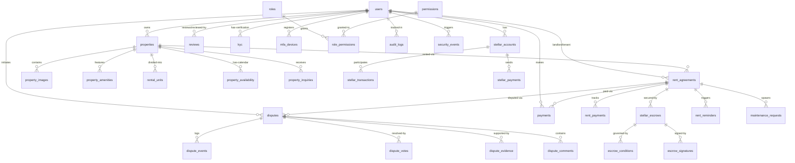

# Database Schema Documentation

## Overview

This document provides a comprehensive reference for the Chioma backend database schema. The database is built on PostgreSQL with TypeORM as the ORM layer, using the `SnakeNamingStrategy` for all table and column names.

**Key Schema Characteristics:**
- Primary keys are predominantly UUIDs (some tables use integers)
- Soft-delete pattern via `deleted_at` timestamps on user-facing entities
- Field-level encryption for PII and sensitive data with companion hash columns for lookups
- Comprehensive indexing strategy for high-traffic query patterns
- Blockchain integration fields linking to Stellar network state

**Database Stack:**
- **Engine**: PostgreSQL 14+
- **ORM**: TypeORM 0.3.x
- **Migrations Table**: `migrations`
- **Local/Test Mode**: PostgreSQL (SQLite for select test flows)
- **Naming Convention**: snake_case via `SnakeNamingStrategy`

---

## Table of Contents

- [Entity Relationship Overview](#entity-relationship-overview)
- [Core Domain Tables](#core-domain-tables)
  - [Users and Identity](#users-and-identity)
  - [Properties and Listings](#properties-and-listings)
  - [Rental Agreements and Payments](#rental-agreements-and-payments)
  - [Reviews and Communication](#reviews-and-communication)
  - [Disputes and Resolution](#disputes-and-resolution)
- [Blockchain Integration Tables](#blockchain-integration-tables)
- [Security and Compliance Tables](#security-and-compliance-tables)
- [System and Integration Tables](#system-and-integration-tables)
- [Migration History](#migration-history)
- [Indexes and Performance](#indexes-and-performance)
- [Data Types and Conventions](#data-types-and-conventions)

---

## Entity Relationship Overview



---

## Core Domain Tables

### Users and Identity

#### `users`

Central identity and authentication table.

| Column                       | Type                        | Constraints                 | Description                                            |
| ---------------------------- | --------------------------- | --------------------------- | ------------------------------------------------------ |
| `id`                         | UUID                        | PRIMARY KEY                 | User unique identifier                                 |
| `email`                      | VARCHAR                     | UNIQUE, NULLABLE            | User email (nullable for wallet-only signups)          |
| `email_encrypted`            | BYTEA                       | NULLABLE, SELECT FALSE      | AES-256-GCM encrypted email                            |
| `email_hash`                 | VARCHAR(64)                 | INDEXED, NULLABLE           | SHA-256 hash for email lookup                          |
| `password`                   | VARCHAR                     | NULLABLE                    | Bcrypt hashed password                                 |
| `first_name`                 | VARCHAR                     | NULLABLE                    | User first name (cleartext)                            |
| `first_name_encrypted`       | BYTEA                       | NULLABLE, SELECT FALSE      | Encrypted first name                                   |
| `last_name`                  | VARCHAR                     | NULLABLE                    | User last name (cleartext)                             |
| `last_name_encrypted`        | BYTEA                       | NULLABLE, SELECT FALSE      | Encrypted last name                                    |
| `phone_number`               | VARCHAR                     | NULLABLE                    | User phone number (cleartext)                          |
| `phone_number_encrypted`     | BYTEA                       | NULLABLE, SELECT FALSE      | Encrypted phone number                                 |
| `phone_number_hash`          | VARCHAR(64)                 | INDEXED, NULLABLE           | SHA-256 hash for phone lookup                          |
| `avatar_url`                 | VARCHAR                     | NULLABLE                    | Profile picture URL                                    |
| `role`                       | ENUM(UserRole)              | DEFAULT 'user'              | User role: user, admin, agent, super_admin             |
| `email_verified`             | BOOLEAN                     | DEFAULT FALSE               | Email verification status                              |
| `email_collected_at`         | TIMESTAMP                   | NULLABLE                    | When email was first collected                         |
| `kyc_status`                 | ENUM(KycStatus)             | DEFAULT 'PENDING'           | KYC verification status                                |
| `verification_token`         | VARCHAR                     | UNIQUE, NULLABLE            | Email verification token                               |
| `verification_token_expires` | TIMESTAMP                   | NULLABLE                    | Verification token expiration                          |
| `reset_token`                | VARCHAR                     | NULLABLE                    | Password reset token                                   |
| `reset_token_expires`        | TIMESTAMP                   | NULLABLE                    | Reset token expiration                                 |
| `failed_login_attempts`      | INTEGER                     | DEFAULT 0                   | Failed login counter                                   |
| `account_locked_until`       | TIMESTAMP                   | NULLABLE                    | Account lockout expiration                             |
| `last_login_at`              | TIMESTAMP                   | NULLABLE                    | Last successful login                                  |
| `login_count`                | INTEGER                     | DEFAULT 0                   | Total login count                                      |
| `preferred_language`         | VARCHAR(10)                 | DEFAULT 'en'                | User language preference                               |
| `timezone`                   | VARCHAR(50)                 | DEFAULT 'UTC'               | User timezone                                          |
| `two_factor_enabled`         | BOOLEAN                     | DEFAULT FALSE               | MFA enabled flag                                       |
| `email_notifications`        | BOOLEAN                     | DEFAULT TRUE                | Email notification preference                          |
| `sms_notifications`          | BOOLEAN                     | DEFAULT FALSE               | SMS notification preference                            |
| `marketing_opt_in`           | BOOLEAN                     | DEFAULT FALSE               | Marketing communication opt-in                         |
| `is_active`                  | BOOLEAN                     | DEFAULT TRUE                | Account active status                                  |
| `wallet_address`             | VARCHAR                     | UNIQUE, NULLABLE            | Stellar wallet address (cleartext)                     |
| `wallet_address_encrypted`   | BYTEA                       | NULLABLE, SELECT FALSE      | Encrypted wallet address                               |
| `wallet_address_hash`        | VARCHAR(64)                 | INDEXED, NULLABLE           | SHA-256 hash for wallet lookup                         |
| `encryption_key_version`     | INTEGER                     | DEFAULT 1, SELECT FALSE     | Encryption key version for rotation                    |
| `auth_method`                | ENUM(AuthMethod)            | DEFAULT 'password'          | Authentication method: password, stellar               |
| `refresh_token`              | VARCHAR                     | NULLABLE                    | JWT refresh token                                      |
| `referral_code`              | VARCHAR(10)                 | UNIQUE, NULLABLE            | User's referral code                                   |
| `referred_by_id`             | UUID                        | NULLABLE, FK → users        | Referrer user ID                                       |
| `created_at`                 | TIMESTAMP                   | NOT NULL                    | Record creation timestamp                              |
| `updated_at`                 | TIMESTAMP                   | NOT NULL                    | Record last update timestamp                           |
| `deleted_at`                 | TIMESTAMP                   | NULLABLE                    | Soft delete timestamp                                  |

**Indexes:**
- `idx_users_email` (email)
- `idx_users_email_hash` (email_hash)
- `idx_users_phone_hash` (phone_number_hash)
- `idx_users_wallet_hash` (wallet_address_hash)
- `idx_users_verification_token` (verification_token, unique)
- `idx_users_referral_code` (referral_code, unique)

**Related Tables:**
- `kyc`: KYC verification data
- `mfa_devices`: Multi-factor authentication devices
- `stellar_accounts`: Blockchain accounts
- `properties`: Owned properties
- `rent_agreements`: Rental agreements (as landlord/tenant/agent)

---

#### `mfa_devices`

Multi-factor authentication device registry.

| Column          | Type      | Constraints         | Description                     |
| --------------- | --------- | ------------------- | ------------------------------- |
| `id`            | UUID      | PRIMARY KEY         | Device unique identifier        |
| `user_id`       | UUID      | NOT NULL, FK→users  | Owner user ID                   |
| `device_name`   | VARCHAR   | NOT NULL            | User-assigned device name       |
| `secret_key`    | VARCHAR   | NOT NULL            | TOTP secret (encrypted at rest) |
| `backup_codes`  | TEXT[]    | NULLABLE            | Recovery codes                  |
| `is_active`     | BOOLEAN   | DEFAULT TRUE        | Device active status            |
| `last_used_at`  | TIMESTAMP | NULLABLE            | Last successful use             |
| `created_at`    | TIMESTAMP | NOT NULL            | Device registration timestamp   |
| `updated_at`    | TIMESTAMP | NOT NULL            | Last update timestamp           |

---

#### `kyc`

KYC (Know Your Customer) verification data storage.

| Column                 | Type             | Constraints        | Description                           |
| ---------------------- | ---------------- | ------------------ | ------------------------------------- |
| `id`                   | UUID             | PRIMARY KEY        | KYC record unique identifier          |
| `user_id`              | UUID             | NOT NULL, FK→users | Associated user                       |
| `status`               | ENUM(KycStatus)  | NOT NULL           | Verification status                   |
| `provider_reference`   | VARCHAR          | NULLABLE           | External provider reference ID        |
| `encrypted_data`       | BYTEA            | NULLABLE           | Encrypted KYC document data           |
| `encryption_version`   | INTEGER          | DEFAULT 1          | Encryption key version                |
| `document_type`        | VARCHAR          | NULLABLE           | ID document type                      |
| `verification_date`    | TIMESTAMP        | NULLABLE           | Date of successful verification       |
| `expiration_date`      | TIMESTAMP        | NULLABLE           | Document/verification expiration date |
| `rejection_reason`     | TEXT             | NULLABLE           | Reason for rejection                  |
| `created_at`           | TIMESTAMP        | NOT NULL           | Record creation timestamp             |
| `updated_at`           | TIMESTAMP        | NOT NULL           | Last update timestamp                 |

---

### Properties and Listings

#### `properties`

Main property listing table.

| Column                    | Type      | Constraints         | Description                             |
| ------------------------- | --------- | ------------------- | --------------------------------------- |
| `id`                      | UUID      | PRIMARY KEY         | Property unique identifier              |
| `title`                   | VARCHAR   | NOT NULL            | Property listing title                  |
| `description`             | TEXT      | NOT NULL            | Detailed property description           |
| `address_line1`           | VARCHAR   | NOT NULL            | Street address                          |
| `address_line2`           | VARCHAR   | NULLABLE            | Apartment/unit number                   |
| `city`                    | VARCHAR   | NOT NULL            | City                                    |
| `state`                   | VARCHAR   | NOT NULL            | State/province                          |
| `postal_code`             | VARCHAR   | NOT NULL            | ZIP/postal code                         |
| `country`                 | VARCHAR   | NOT NULL            | Country code (ISO 3166-1)               |
| `latitude`                | DECIMAL   | NULLABLE            | Geolocation latitude                    |
| `longitude`               | DECIMAL   | NULLABLE            | Geolocation longitude                   |
| `property_type`           | VARCHAR   | NOT NULL            | Type: apartment, house, condo, etc.     |
| `bedrooms`                | INTEGER   | NOT NULL            | Number of bedrooms                      |
| `bathrooms`               | DECIMAL   | NOT NULL            | Number of bathrooms                     |
| `square_feet`             | INTEGER   | NULLABLE            | Property area in square feet            |
| `monthly_rent`            | DECIMAL   | NOT NULL            | Base monthly rent amount                |
| `currency`                | VARCHAR   | DEFAULT 'USD'       | Rent currency code                      |
| `security_deposit`        | DECIMAL   | NULLABLE            | Security deposit amount                 |
| `lease_duration_months`   | INTEGER   | DEFAULT 12          | Default lease duration                  |
| `available_from`          | DATE      | NOT NULL            | Availability start date                 |
| `is_available`            | BOOLEAN   | DEFAULT TRUE        | Current availability flag               |
| `pets_allowed`            | BOOLEAN   | DEFAULT FALSE       | Pets allowed flag                       |
| `smoking_allowed`         | BOOLEAN   | DEFAULT FALSE       | Smoking allowed flag                    |
| `max_occupants`           | INTEGER   | NULLABLE            | Maximum occupant limit                  |
| `owner_id`                | UUID      | NOT NULL, FK→users  | Property owner user ID                  |
| `is_verified`             | BOOLEAN   | DEFAULT FALSE       | Admin verification status               |
| `view_count`              | INTEGER   | DEFAULT 0           | Total view counter                      |
| `inquiry_count`           | INTEGER   | DEFAULT 0           | Total inquiry counter                   |
| `featured`                | BOOLEAN   | DEFAULT FALSE       | Featured listing flag                   |
| `listing_status`          | VARCHAR   | DEFAULT 'active'    | Status: active, inactive, rented        |
| `primary_image_url`       | VARCHAR   | NULLABLE            | Primary listing image URL               |
| `virtual_tour_url`        | VARCHAR   | NULLABLE            | Virtual tour link                       |
| `created_at`              | TIMESTAMP | NOT NULL            | Listing creation timestamp              |
| `updated_at`              | TIMESTAMP | NOT NULL            | Last update timestamp                   |
| `deleted_at`              | TIMESTAMP | NULLABLE            | Soft delete timestamp                   |

**Indexes:**
- `idx_properties_owner_id` (owner_id)
- `idx_properties_listing_status` (listing_status)
- `idx_properties_location` (city, state, country)
- `idx_properties_available_from` (available_from)
- GiST index on lat/long for geospatial queries (location)

**Related Tables:**
- `property_images`: Property photos
- `property_amenities`: Property features
- `rental_units`: Multi-unit properties
- `property_availability`: Availability calendar
- `property_inquiries`: User inquiries

---

#### `property_images`

Property listing photos.

| Column       | Type      | Constraints            | Description                      |
| ------------ | --------- | ---------------------- | -------------------------------- |
| `id`         | UUID      | PRIMARY KEY            | Image unique identifier          |
| `property_id`| UUID      | NOT NULL, FK→properties| Parent property                  |
| `url`        | VARCHAR   | NOT NULL               | Image URL (S3/CDN)               |
| `caption`    | VARCHAR   | NULLABLE               | Image caption/description        |
| `sort_order` | INTEGER   | DEFAULT 0              | Display order                    |
| `is_primary` | BOOLEAN   | DEFAULT FALSE          | Primary image flag               |
| `created_at` | TIMESTAMP | NOT NULL               | Upload timestamp                 |

---

#### `property_amenities`

Property features and amenities.

| Column        | Type      | Constraints            | Description                      |
| ------------- | --------- | ---------------------- | -------------------------------- |
| `id`          | UUID      | PRIMARY KEY            | Amenity unique identifier        |
| `property_id` | UUID      | NOT NULL, FK→properties| Parent property                  |
| `name`        | VARCHAR   | NOT NULL               | Amenity name                     |
| `icon`        | VARCHAR   | NULLABLE               | Icon identifier                  |
| `category`    | VARCHAR   | NULLABLE               | Amenity category                 |
| `created_at`  | TIMESTAMP | NOT NULL               | Record creation timestamp        |

---

#### `property_availability`

Property availability calendar.

| Column                | Type      | Constraints            | Description                        |
| --------------------- | --------- | ---------------------- | ---------------------------------- |
| `id`                  | UUID      | PRIMARY KEY            | Availability record identifier     |
| `property_id`         | UUID      | NOT NULL, FK→properties| Parent property                    |
| `date`                | DATE      | NOT NULL               | Calendar date                      |
| `available`           | BOOLEAN   | DEFAULT TRUE           | Available flag for this date       |
| `blocked_by_booking_id`| UUID     | NULLABLE               | Booking ID if blocked              |
| `notes`               | TEXT      | NULLABLE               | Availability notes                 |
| `created_at`          | TIMESTAMP | NOT NULL               | Record creation timestamp          |
| `updated_at`          | TIMESTAMP | NOT NULL               | Last update timestamp              |

**Indexes:**
- `idx_property_availability_property_date` (property_id, date, unique)

---

#### `property_listing_drafts`

Draft storage for property listing wizard.

| Column           | Type      | Constraints         | Description                          |
| ---------------- | --------- | ------------------- | ------------------------------------ |
| `id`             | UUID      | PRIMARY KEY         | Draft unique identifier              |
| `landlord_id`    | UUID      | NOT NULL, FK→users  | Draft author                         |
| `current_step`   | INTEGER   | DEFAULT 1           | Current wizard step (1-8)            |
| `draft_data`     | JSONB     | NOT NULL            | Serialized draft state               |
| `expires_at`     | TIMESTAMP | NOT NULL            | Draft expiration (30 days default)   |
| `created_at`     | TIMESTAMP | NOT NULL            | Draft creation timestamp             |
| `updated_at`     | TIMESTAMP | NOT NULL            | Last save timestamp                  |

---

### Rental Agreements and Payments

#### `rent_agreements`

Core rental agreement contracts.

| Column                      | Type      | Constraints            | Description                                |
| --------------------------- | --------- | ---------------------- | ------------------------------------------ |
| `id`                        | UUID      | PRIMARY KEY            | Agreement unique identifier                |
| `agreement_number`          | VARCHAR   | UNIQUE, NOT NULL       | Human-readable agreement number            |
| `property_id`               | UUID      | NOT NULL, FK→properties| Associated property                        |
| `landlord_id`               | UUID      | NOT NULL, FK→users     | Landlord user ID                           |
| `tenant_id`                 | UUID      | NOT NULL, FK→users     | Tenant user ID                             |
| `agent_id`                  | UUID      | NULLABLE, FK→users     | Optional agent user ID                     |
| `start_date`                | DATE      | NOT NULL               | Lease start date                           |
| `end_date`                  | DATE      | NOT NULL               | Lease end date                             |
| `monthly_rent`              | DECIMAL   | NOT NULL               | Monthly rent amount                        |
| `currency`                  | VARCHAR   | DEFAULT 'USD'          | Rent currency                              |
| `security_deposit`          | DECIMAL   | NULLABLE               | Security deposit amount                    |
| `payment_day`               | INTEGER   | NOT NULL               | Monthly payment due day (1-31)             |
| `agent_commission_percent`  | DECIMAL   | DEFAULT 0              | Agent commission percentage                |
| `landlord_share_percent`    | DECIMAL   | DEFAULT 100            | Landlord payment share percentage          |
| `status`                    | VARCHAR   | DEFAULT 'pending'      | Status: pending, active, completed, etc.   |
| `blockchain_transaction_hash`| VARCHAR  | NULLABLE               | Stellar transaction hash                   |
| `blockchain_created_at`     | TIMESTAMP | NULLABLE               | Blockchain creation timestamp              |
| `nft_minted`                | BOOLEAN   | DEFAULT FALSE          | Rent obligation NFT minted flag            |
| `nft_token_id`              | VARCHAR   | NULLABLE               | NFT token identifier                       |
| `contract_document_url`     | VARCHAR   | NULLABLE               | Signed contract document URL               |
| `terms_accepted_at`         | TIMESTAMP | NULLABLE               | Timestamp when terms were accepted         |
| `created_at`                | TIMESTAMP | NOT NULL               | Agreement creation timestamp               |
| `updated_at`                | TIMESTAMP | NOT NULL               | Last update timestamp                      |
| `deleted_at`                | TIMESTAMP | NULLABLE               | Soft delete timestamp                      |

**Indexes:**
- `idx_rent_agreements_landlord` (landlord_id)
- `idx_rent_agreements_tenant` (tenant_id)
- `idx_rent_agreements_property` (property_id)
- `idx_rent_agreements_status` (status)
- `idx_rent_agreements_dates` (start_date, end_date)

---

#### `payments`

General payment ledger.

| Column                | Type      | Constraints                | Description                           |
| --------------------- | --------- | -------------------------- | ------------------------------------- |
| `id`                  | UUID      | PRIMARY KEY                | Payment unique identifier             |
| `user_id`             | UUID      | NOT NULL, FK→users         | Payer user ID                         |
| `agreement_id`        | UUID      | NULLABLE, FK→rent_agreements| Associated agreement                 |
| `amount`              | DECIMAL   | NOT NULL                   | Payment amount                        |
| `currency`            | VARCHAR   | DEFAULT 'USD'              | Payment currency                      |
| `status`              | VARCHAR   | NOT NULL                   | Status: pending, completed, failed    |
| `payment_method_id`   | UUID      | NULLABLE, FK→payment_methods| Payment method used                  |
| `payment_type`        | VARCHAR   | NOT NULL                   | Type: rent, deposit, commission       |
| `reference_number`    | VARCHAR   | UNIQUE, NULLABLE           | External payment reference            |
| `idempotency_key`     | VARCHAR   | UNIQUE, NULLABLE           | Idempotency key for retry safety      |
| `receipt_url`         | VARCHAR   | NULLABLE                   | Payment receipt URL                   |
| `refund_amount`       | DECIMAL   | DEFAULT 0                  | Total refunded amount                 |
| `refund_reason`       | TEXT      | NULLABLE                   | Refund justification                  |
| `processed_at`        | TIMESTAMP | NULLABLE                   | Payment processing timestamp          |
| `created_at`          | TIMESTAMP | NOT NULL                   | Payment record creation timestamp     |
| `updated_at`          | TIMESTAMP | NOT NULL                   | Last update timestamp                 |

**Indexes:**
- `idx_payments_user_id` (user_id)
- `idx_payments_status` (status)
- `idx_payments_processed_at` (processed_at)

---

#### `payment_methods`

Saved payment instruments.

| Column            | Type      | Constraints         | Description                          |
| ----------------- | --------- | ------------------- | ------------------------------------ |
| `id`              | UUID      | PRIMARY KEY         | Payment method unique identifier     |
| `user_id`         | UUID      | NOT NULL, FK→users  | Owner user ID                        |
| `payment_type`    | VARCHAR   | NOT NULL            | Type: card, bank, stellar            |
| `last_four`       | VARCHAR   | NULLABLE            | Last 4 digits of card/account        |
| `expiry_date`     | VARCHAR   | NULLABLE            | Card expiration (MM/YY)              |
| `is_default`      | BOOLEAN   | DEFAULT FALSE       | Default payment method flag          |
| `encrypted_metadata`| BYTEA   | NULLABLE            | Encrypted sensitive payment details  |
| `created_at`      | TIMESTAMP | NOT NULL            | Method creation timestamp            |
| `updated_at`      | TIMESTAMP | NOT NULL            | Last update timestamp                |

---

#### `payment_schedules`

Recurring payment scheduling.

| Column               | Type      | Constraints                 | Description                           |
| -------------------- | --------- | --------------------------- | ------------------------------------- |
| `id`                 | UUID      | PRIMARY KEY                 | Schedule unique identifier            |
| `user_id`            | UUID      | NOT NULL, FK→users          | Payer user ID                         |
| `agreement_id`       | UUID      | NULLABLE, FK→rent_agreements| Associated agreement                  |
| `payment_method_id`  | UUID      | NOT NULL, FK→payment_methods| Payment method to charge              |
| `amount`             | DECIMAL   | NOT NULL                    | Scheduled payment amount              |
| `currency`           | VARCHAR   | DEFAULT 'USD'               | Payment currency                      |
| `interval`           | VARCHAR   | NOT NULL                    | Frequency: monthly, weekly, etc.      |
| `next_run_at`        | TIMESTAMP | NOT NULL                    | Next scheduled execution              |
| `last_run_at`        | TIMESTAMP | NULLABLE                    | Last execution timestamp              |
| `retry_count`        | INTEGER   | DEFAULT 0                   | Failed retry counter                  |
| `max_retries`        | INTEGER   | DEFAULT 3                   | Maximum retry attempts                |
| `status`             | VARCHAR   | DEFAULT 'active'            | Status: active, paused, completed     |
| `created_at`         | TIMESTAMP | NOT NULL                    | Schedule creation timestamp           |
| `updated_at`         | TIMESTAMP | NOT NULL                    | Last update timestamp                 |

**Indexes:**
- `idx_payment_schedules_user_id` (user_id)
- `idx_payment_schedules_next_run_at` (next_run_at)

---

#### `rent_payments`

Rent-specific payment tracking.

| Column                | Type      | Constraints                | Description                           |
| --------------------- | --------- | -------------------------- | ------------------------------------- |
| `id`                  | UUID      | PRIMARY KEY                | Rent payment unique identifier        |
| `agreement_id`        | UUID      | NOT NULL, FK→rent_agreements| Associated agreement                 |
| `amount`              | DECIMAL   | NOT NULL                   | Payment amount                        |
| `currency`            | VARCHAR   | DEFAULT 'USD'              | Payment currency                      |
| `status`              | VARCHAR   | NOT NULL                   | Status: pending, paid, overdue        |
| `due_date`            | DATE      | NOT NULL                   | Payment due date                      |
| `paid_at`             | TIMESTAMP | NULLABLE                   | Actual payment timestamp              |
| `reference_number`    | VARCHAR   | NULLABLE                   | External payment reference            |
| `notes`               | TEXT      | NULLABLE                   | Payment notes                         |
| `created_at`          | TIMESTAMP | NOT NULL                   | Record creation timestamp             |
| `updated_at`          | TIMESTAMP | NOT NULL                   | Last update timestamp                 |

---

#### `maintenance_requests`

Property maintenance request tracking.

| Column          | Type      | Constraints                | Description                           |
| --------------- | --------- | -------------------------- | ------------------------------------- |
| `id`            | UUID      | PRIMARY KEY                | Request unique identifier             |
| `property_id`   | UUID      | NOT NULL, FK→properties    | Associated property                   |
| `tenant_id`     | UUID      | NOT NULL, FK→users         | Requesting tenant                     |
| `landlord_id`   | UUID      | NOT NULL, FK→users         | Property landlord                     |
| `category`      | VARCHAR   | NOT NULL                   | Category: plumbing, electrical, etc.  |
| `priority`      | VARCHAR   | DEFAULT 'medium'           | Priority: low, medium, high, urgent   |
| `title`         | VARCHAR   | NOT NULL                   | Request title                         |
| `description`   | TEXT      | NOT NULL                   | Detailed description                  |
| `status`        | VARCHAR   | DEFAULT 'pending'          | Status: pending, in_progress, etc.    |
| `media_urls`    | TEXT[]    | NULLABLE                   | Uploaded photo/video URLs             |
| `resolved_at`   | TIMESTAMP | NULLABLE                   | Resolution timestamp                  |
| `created_at`    | TIMESTAMP | NOT NULL                   | Request creation timestamp            |
| `updated_at`    | TIMESTAMP | NOT NULL                   | Last update timestamp                 |

---

### Reviews and Communication

#### `reviews`

General review system (polymorphic).

| Column          | Type      | Constraints         | Description                           |
| --------------- | --------- | ------------------- | ------------------------------------- |
| `id`            | UUID      | PRIMARY KEY         | Review unique identifier              |
| `reviewer_id`   | UUID      | NOT NULL, FK→users  | Reviewer user ID                      |
| `reviewee_id`   | UUID      | NOT NULL, FK→users  | Reviewed user ID                      |
| `rating`        | INTEGER   | NOT NULL            | Rating (1-5)                          |
| `comment`       | TEXT      | NULLABLE            | Review comment text                   |
| `context`       | VARCHAR   | NOT NULL            | Context: tenant, landlord, agent      |
| `property_id`   | UUID      | NULLABLE, FK→properties| Associated property                 |
| `is_reported`   | BOOLEAN   | DEFAULT FALSE       | Flagged for moderation                |
| `created_at`    | TIMESTAMP | NOT NULL            | Review creation timestamp             |
| `updated_at`    | TIMESTAMP | NOT NULL            | Last update timestamp                 |

**Indexes:**
- `idx_reviews_reviewer_id` (reviewer_id)
- `idx_reviews_reviewee_id` (reviewee_id)

---

#### `guest_reviews`

Guest-specific review details.

| Column                    | Type      | Constraints         | Description                           |
| ------------------------- | --------- | ------------------- | ------------------------------------- |
| `id`                      | UUID      | PRIMARY KEY         | Guest review unique identifier        |
| `booking_id`              | UUID      | NOT NULL            | Associated booking                    |
| `host_id`                 | UUID      | NOT NULL, FK→users  | Reviewing host                        |
| `guest_id`                | UUID      | NOT NULL, FK→users  | Reviewed guest                        |
| `cleanliness_rating`      | INTEGER   | NOT NULL            | Cleanliness score (1-5)               |
| `communication_rating`    | INTEGER   | NOT NULL            | Communication score (1-5)             |
| `house_rules_rating`      | INTEGER   | NOT NULL            | House rules adherence (1-5)           |
| `overall_rating`          | INTEGER   | NOT NULL            | Overall rating (1-5)                  |
| `comment`                 | TEXT      | NULLABLE            | Review comment                        |
| `created_at`              | TIMESTAMP | NOT NULL            | Review creation timestamp             |

**Indexes:**
- `idx_guest_reviews_booking_host` (booking_id, host_id, unique)
- `idx_guest_reviews_guest_id` (guest_id)

---

#### `host_reviews`

Host-specific review details.

| Column                    | Type      | Constraints         | Description                           |
| ------------------------- | --------- | ------------------- | ------------------------------------- |
| `id`                      | UUID      | PRIMARY KEY         | Host review unique identifier         |
| `booking_id`              | UUID      | NOT NULL            | Associated booking                    |
| `guest_id`                | UUID      | NOT NULL, FK→users  | Reviewing guest                       |
| `host_id`                 | UUID      | NOT NULL, FK→users  | Reviewed host                         |
| `accuracy_rating`         | INTEGER   | NOT NULL            | Listing accuracy score (1-5)          |
| `communication_rating`    | INTEGER   | NOT NULL            | Communication score (1-5)             |
| `cleanliness_rating`      | INTEGER   | NOT NULL            | Property cleanliness (1-5)            |
| `location_rating`         | INTEGER   | NOT NULL            | Location score (1-5)                  |
| `value_rating`            | INTEGER   | NOT NULL            | Value for money (1-5)                 |
| `overall_rating`          | INTEGER   | NOT NULL            | Overall rating (1-5)                  |
| `comment`                 | TEXT      | NULLABLE            | Review comment                        |
| `created_at`              | TIMESTAMP | NOT NULL            | Review creation timestamp             |

**Indexes:**
- `idx_host_reviews_booking_guest` (booking_id, guest_id, unique)
- `idx_host_reviews_host_id` (host_id)

---

### Disputes and Resolution

#### `disputes`

Dispute lifecycle management.

| Column                        | Type      | Constraints                | Description                           |
| ----------------------------- | --------- | -------------------------- | ------------------------------------- |
| `id`                          | UUID      | PRIMARY KEY                | Dispute unique identifier             |
| `agreement_id`                | UUID      | NULLABLE, FK→rent_agreements| Associated agreement                 |
| `payment_id`                  | UUID      | NULLABLE, FK→payments      | Disputed payment                      |
| `rent_payment_id`             | UUID      | NULLABLE                   | Disputed rent payment                 |
| `initiator_id`                | UUID      | NOT NULL, FK→users         | User who initiated dispute            |
| `respondent_id`               | UUID      | NOT NULL, FK→users         | Responding party                      |
| `dispute_type`                | VARCHAR   | NOT NULL                   | Type: payment, property, etc.         |
| `status`                      | VARCHAR   | DEFAULT 'open'             | Status: open, in_review, resolved     |
| `description`                 | TEXT      | NOT NULL                   | Dispute description                   |
| `resolution`                  | TEXT      | NULLABLE                   | Final resolution text                 |
| `blockchain_escrow_id`        | VARCHAR   | NULLABLE                   | Linked Stellar escrow                 |
| `total_votes`                 | INTEGER   | DEFAULT 0                  | Total arbiter votes                   |
| `votes_for_initiator`         | INTEGER   | DEFAULT 0                  | Votes favoring initiator              |
| `votes_for_respondent`        | INTEGER   | DEFAULT 0                  | Votes favoring respondent             |
| `blockchain_transaction_hash` | VARCHAR   | NULLABLE                   | Resolution transaction hash           |
| `resolved_at`                 | TIMESTAMP | NULLABLE                   | Resolution timestamp                  |
| `created_at`                  | TIMESTAMP | NOT NULL                   | Dispute creation timestamp            |
| `updated_at`                  | TIMESTAMP | NOT NULL                   | Last update timestamp                 |

**Indexes:**
- `IDX_disputes_payment_id` (payment_id)
- `IDX_disputes_rent_payment_id` (rent_payment_id)
- `IDX_disputes_status` (status)

---

#### `dispute_evidence`

Uploaded evidence attachments.

| Column          | Type      | Constraints         | Description                           |
| --------------- | --------- | ------------------- | ------------------------------------- |
| `id`            | INTEGER   | PRIMARY KEY         | Evidence unique identifier            |
| `dispute_id`    | UUID      | NOT NULL, FK→disputes| Parent dispute                       |
| `uploader_id`   | UUID      | NOT NULL, FK→users  | User who uploaded evidence            |
| `file_url`      | VARCHAR   | NOT NULL            | Evidence file URL                     |
| `file_name`     | VARCHAR   | NOT NULL            | Original file name                    |
| `file_size`     | INTEGER   | NULLABLE            | File size in bytes                    |
| `file_type`     | VARCHAR   | NULLABLE            | MIME type                             |
| `description`   | TEXT      | NULLABLE            | Evidence description                  |
| `uploaded_at`   | TIMESTAMP | NOT NULL            | Upload timestamp                      |

---

#### `dispute_comments`

Dispute discussion thread.

| Column          | Type      | Constraints         | Description                           |
| --------------- | --------- | ------------------- | ------------------------------------- |
| `id`            | INTEGER   | PRIMARY KEY         | Comment unique identifier             |
| `dispute_id`    | UUID      | NOT NULL, FK→disputes| Parent dispute                       |
| `user_id`       | UUID      | NOT NULL, FK→users  | Comment author                        |
| `content`       | TEXT      | NOT NULL            | Comment text                          |
| `is_internal`   | BOOLEAN   | DEFAULT FALSE       | Internal admin comment flag           |
| `created_at`    | TIMESTAMP | NOT NULL            | Comment creation timestamp            |

---

#### `dispute_votes`

Arbiter voting records.

| Column          | Type      | Constraints            | Description                           |
| --------------- | --------- | ---------------------- | ------------------------------------- |
| `id`            | UUID      | PRIMARY KEY            | Vote unique identifier                |
| `dispute_id`    | UUID      | NOT NULL, FK→disputes  | Disputed case                         |
| `arbiter_id`    | UUID      | NOT NULL, FK→arbiters  | Voting arbiter                        |
| `vote_decision` | VARCHAR   | NOT NULL               | Decision: for_initiator, for_respondent|
| `vote_weight`   | INTEGER   | DEFAULT 1              | Vote weight (future use)              |
| `reasoning`     | TEXT      | NULLABLE               | Vote justification                    |
| `evidence_reviewed`| TEXT[] | NULLABLE               | Evidence IDs reviewed                 |
| `created_at`    | TIMESTAMP | NOT NULL               | Vote timestamp                        |

**Indexes:**
- `IDX_dispute_votes_dispute_arbiter` (dispute_id, arbiter_id, unique)

---

#### `arbiters`

Dispute arbiter registry.

| Column                          | Type      | Constraints         | Description                           |
| ------------------------------- | --------- | ------------------- | ------------------------------------- |
| `id`                            | UUID      | PRIMARY KEY         | Arbiter unique identifier             |
| `user_id`                       | UUID      | NOT NULL, FK→users  | Associated user account               |
| `stellar_address`               | VARCHAR   | UNIQUE, NOT NULL    | Arbiter's Stellar address             |
| `active`                        | BOOLEAN   | DEFAULT TRUE        | Active arbiter flag                   |
| `total_cases_resolved`          | INTEGER   | DEFAULT 0           | Total resolved dispute count          |
| `blockchain_registration_hash`  | VARCHAR   | NULLABLE            | Registration transaction hash         |
| `blockchain_registered_at`      | TIMESTAMP | NULLABLE            | Blockchain registration timestamp     |
| `created_at`                    | TIMESTAMP | NOT NULL            | Arbiter creation timestamp            |
| `updated_at`                    | TIMESTAMP | NOT NULL            | Last update timestamp                 |

**Indexes:**
- `IDX_arbiters_stellar_address` (stellar_address)
- `IDX_arbiters_active` (active)

---

## Blockchain Integration Tables

### `stellar_accounts`

Managed Stellar blockchain accounts.

| Column                | Type      | Constraints         | Description                           |
| --------------------- | --------- | ------------------- | ------------------------------------- |
| `id`                  | UUID      | PRIMARY KEY         | Account record unique identifier      |
| `user_id`             | UUID      | NOT NULL, FK→users  | Associated user                       |
| `public_key`          | VARCHAR   | UNIQUE, NOT NULL    | Stellar public key                    |
| `secret_encrypted`    | BYTEA     | NOT NULL            | Encrypted secret key                  |
| `account_type`        | VARCHAR   | NOT NULL            | Type: user, escrow, agent             |
| `balance`             | DECIMAL   | DEFAULT 0           | Current XLM balance                   |
| `sequence`            | VARCHAR   | NULLABLE            | Current account sequence number       |
| `is_active`           | BOOLEAN   | DEFAULT TRUE        | Account active flag                   |
| `created_at`          | TIMESTAMP | NOT NULL            | Account creation timestamp            |
| `updated_at`          | TIMESTAMP | NOT NULL            | Last update timestamp                 |

**Indexes:**
- `IDX_stellar_accounts_user_id` (user_id)
- `IDX_stellar_accounts_account_type` (account_type)

---

### `stellar_escrows`

Stellar escrow state tracking.

| Column                      | Type      | Constraints                  | Description                           |
| --------------------------- | --------- | ---------------------------- | ------------------------------------- |
| `id`                        | UUID      | PRIMARY KEY                  | Escrow unique identifier              |
| `source_account_id`         | UUID      | NOT NULL, FK→stellar_accounts| Source account                        |
| `destination_account_id`    | UUID      | NOT NULL, FK→stellar_accounts| Destination account                   |
| `asset_code`                | VARCHAR   | NOT NULL                     | Stellar asset code                    |
| `asset_issuer`              | VARCHAR   | NULLABLE                     | Asset issuer address                  |
| `amount`                    | DECIMAL   | NOT NULL                     | Escrow amount                         |
| `status`                    | VARCHAR   | DEFAULT 'pending'            | Status: pending, locked, released     |
| `release_conditions`        | JSONB     | NULLABLE                     | Release condition data                |
| `expiration_date`           | TIMESTAMP | NULLABLE                     | Escrow expiration                     |
| `transaction_hash`          | VARCHAR   | NULLABLE                     | Creation transaction hash             |
| `dispute_id`                | UUID      | NULLABLE, FK→disputes        | Associated dispute                    |
| `requires_multisig`         | BOOLEAN   | DEFAULT FALSE                | Multi-signature requirement flag      |
| `signers_required`          | INTEGER   | DEFAULT 1                    | Required signer count                 |
| `refunded_amount`           | DECIMAL   | DEFAULT 0                    | Amount refunded                       |
| `created_at`                | TIMESTAMP | NOT NULL                     | Escrow creation timestamp             |
| `updated_at`                | TIMESTAMP | NOT NULL                     | Last update timestamp                 |

**Indexes:**
- `IDX_stellar_escrows_source_account` (source_account_id)
- `IDX_stellar_escrows_destination_account` (destination_account_id)
- `IDX_stellar_escrows_status` (status)

---

### `stellar_payments`

Stellar payment transaction mirror.

| Column                | Type      | Constraints                | Description                           |
| --------------------- | --------- | -------------------------- | ------------------------------------- |
| `id`                  | UUID      | PRIMARY KEY                | Payment record unique identifier      |
| `agreement_id`        | UUID      | NULLABLE, FK→rent_agreements| Associated agreement                 |
| `from_address`        | VARCHAR   | NOT NULL                   | Sender Stellar address                |
| `to_address`          | VARCHAR   | NOT NULL                   | Recipient Stellar address             |
| `amount`              | DECIMAL   | NOT NULL                   | Payment amount                        |
| `asset_code`          | VARCHAR   | NOT NULL                   | Asset code                            |
| `asset_issuer`        | VARCHAR   | NULLABLE                   | Asset issuer address                  |
| `transaction_hash`    | VARCHAR   | UNIQUE, NOT NULL           | Stellar transaction hash              |
| `status`              | VARCHAR   | DEFAULT 'pending'          | Status: pending, completed, failed    |
| `payment_date`        | TIMESTAMP | NOT NULL                   | Payment execution timestamp           |
| `created_at`          | TIMESTAMP | NOT NULL                   | Record creation timestamp             |

**Indexes:**
- `IDX_stellar_payments_agreement_id` (agreement_id)
- `IDX_stellar_payments_status` (status)

---

### `stellar_transactions`

General Stellar transaction index.

| Column                | Type      | Constraints                  | Description                           |
| --------------------- | --------- | ---------------------------- | ------------------------------------- |
| `id`                  | UUID      | PRIMARY KEY                  | Transaction record identifier         |
| `transaction_hash`    | VARCHAR   | UNIQUE, NOT NULL             | Stellar transaction hash              |
| `ledger`              | INTEGER   | NOT NULL                     | Ledger number                         |
| `from_account_id`     | UUID      | NULLABLE, FK→stellar_accounts| Sender account                        |
| `to_account_id`       | UUID      | NULLABLE, FK→stellar_accounts| Recipient account                     |
| `transaction_type`    | VARCHAR   | NOT NULL                     | Type: payment, escrow, etc.           |
| `amount`              | DECIMAL   | NULLABLE                     | Transaction amount                    |
| `asset_code`          | VARCHAR   | NULLABLE                     | Asset code                            |
| `asset_issuer`        | VARCHAR   | NULLABLE                     | Asset issuer                          |
| `fee`                 | INTEGER   | NOT NULL                     | Transaction fee (stroops)             |
| `memo`                | VARCHAR   | NULLABLE                     | Transaction memo                      |
| `status`              | VARCHAR   | DEFAULT 'pending'            | Status: pending, success, failed      |
| `error_message`       | TEXT      | NULLABLE                     | Error message on failure              |
| `created_at`          | TIMESTAMP | NOT NULL                     | Record creation timestamp             |

**Indexes:**
- `IDX_stellar_transactions_from_account` (from_account_id)
- `IDX_stellar_transactions_to_account` (to_account_id)
- `IDX_stellar_transactions_hash` (transaction_hash)

---

### `rent_obligation_nfts`

NFT-backed rent obligation tracking.

| Column                | Type      | Constraints                | Description                           |
| --------------------- | --------- | -------------------------- | ------------------------------------- |
| `id`                  | UUID      | PRIMARY KEY                | NFT record unique identifier          |
| `agreement_id`        | UUID      | NOT NULL, FK→rent_agreements| Associated agreement                 |
| `nft_token_id`        | VARCHAR   | UNIQUE, NOT NULL           | NFT token identifier                  |
| `owner_address`       | VARCHAR   | NOT NULL                   | Current NFT owner address             |
| `mint_transaction_hash`| VARCHAR  | NULLABLE                   | Minting transaction hash              |
| `transfer_count`      | INTEGER   | DEFAULT 0                  | Number of transfers                   |
| `status`              | VARCHAR   | DEFAULT 'active'           | Status: active, burned, transferred   |
| `metadata_uri`        | VARCHAR   | NULLABLE                   | NFT metadata URI                      |
| `created_at`          | TIMESTAMP | NOT NULL                   | Minting timestamp                     |
| `updated_at`          | TIMESTAMP | NOT NULL                   | Last update timestamp                 |

---

## Security and Compliance Tables

### `roles`

RBAC role catalog.

| Column          | Type      | Constraints         | Description                           |
| --------------- | --------- | ------------------- | ------------------------------------- |
| `id`            | UUID      | PRIMARY KEY         | Role unique identifier                |
| `name`          | VARCHAR   | UNIQUE, NOT NULL    | Role name                             |
| `description`   | TEXT      | NULLABLE            | Role description                      |
| `system_role`   | BOOLEAN   | DEFAULT FALSE       | System-defined role flag              |
| `is_active`     | BOOLEAN   | DEFAULT TRUE        | Role active status                    |
| `created_at`    | TIMESTAMP | NOT NULL            | Role creation timestamp               |
| `updated_at`    | TIMESTAMP | NOT NULL            | Last update timestamp                 |

---

### `permissions`

RBAC permission catalog.

| Column          | Type      | Constraints         | Description                           |
| --------------- | --------- | ------------------- | ------------------------------------- |
| `id`            | UUID      | PRIMARY KEY         | Permission unique identifier          |
| `name`          | VARCHAR   | UNIQUE, NOT NULL    | Permission name                       |
| `resource`      | VARCHAR   | NOT NULL            | Resource type                         |
| `action`        | VARCHAR   | NOT NULL            | Action: read, write, delete, etc.     |
| `description`   | TEXT      | NULLABLE            | Permission description                |
| `is_active`     | BOOLEAN   | DEFAULT TRUE        | Permission active status              |
| `created_at`    | TIMESTAMP | NOT NULL            | Permission creation timestamp         |
| `updated_at`    | TIMESTAMP | NOT NULL            | Last update timestamp                 |

---

### `role_permissions`

Many-to-many role-permission mapping.

| Column          | Type      | Constraints         | Description                           |
| --------------- | --------- | ------------------- | ------------------------------------- |
| `role_id`       | UUID      | FK→roles            | Role ID                               |
| `permission_id` | UUID      | FK→permissions      | Permission ID                         |

**Indexes:**
- PRIMARY KEY (role_id, permission_id)

---

### `audit_logs`

Immutable audit trail.

| Column          | Type      | Constraints         | Description                           |
| --------------- | --------- | ------------------- | ------------------------------------- |
| `id`            | INTEGER   | PRIMARY KEY         | Audit log entry identifier            |
| `action`        | VARCHAR   | NOT NULL            | Action performed                      |
| `entity_type`   | VARCHAR   | NOT NULL            | Entity type affected                  |
| `entity_id`     | VARCHAR   | NULLABLE            | Entity identifier                     |
| `performed_by`  | UUID      | NULLABLE, FK→users  | User who performed action             |
| `status`        | VARCHAR   | NOT NULL            | Status: success, failure              |
| `ip_address`    | VARCHAR   | NULLABLE            | Request IP address                    |
| `user_agent`    | VARCHAR   | NULLABLE            | Request user agent                    |
| `metadata`      | JSONB     | NULLABLE            | Additional context data               |
| `timestamp`     | TIMESTAMP | NOT NULL            | Event timestamp                       |

**Indexes:**
- `idx_audit_logs_entity` (entity_type, entity_id)
- `idx_audit_logs_performed_by` (performed_by)
- `idx_audit_logs_timestamp` (timestamp)

---

### `security_events`

Security telemetry events.

| Column          | Type      | Constraints         | Description                           |
| --------------- | --------- | ------------------- | ------------------------------------- |
| `id`            | UUID      | PRIMARY KEY         | Event unique identifier               |
| `user_id`       | UUID      | NULLABLE, FK→users  | Associated user                       |
| `event_type`    | VARCHAR   | NOT NULL            | Event type: login, logout, etc.       |
| `severity`      | VARCHAR   | NOT NULL            | Severity: low, medium, high, critical |
| `ip_address`    | VARCHAR   | NULLABLE            | Source IP address                     |
| `user_agent`    | VARCHAR   | NULLABLE            | User agent string                     |
| `details`       | JSONB     | NULLABLE            | Event details                         |
| `success`       | BOOLEAN   | NOT NULL            | Success flag                          |
| `error_message` | TEXT      | NULLABLE            | Error message on failure              |
| `timestamp`     | TIMESTAMP | NOT NULL            | Event timestamp                       |

**Indexes:**
- `idx_security_events_user_id` (user_id)
- `idx_security_events_timestamp` (timestamp)
- `idx_security_events_severity` (severity)

---

### `threat_events`

Threat detection findings.

| Column                | Type      | Constraints         | Description                           |
| --------------------- | --------- | ------------------- | ------------------------------------- |
| `id`                  | UUID      | PRIMARY KEY         | Threat event unique identifier        |
| `user_id`             | UUID      | NULLABLE, FK→users  | Associated user                       |
| `ip_address`          | VARCHAR   | NOT NULL            | Source IP address                     |
| `user_agent`          | VARCHAR   | NULLABLE            | User agent string                     |
| `threat_type`         | VARCHAR   | NOT NULL            | Threat type                           |
| `threat_level`        | VARCHAR   | NOT NULL            | Level: low, medium, high, critical    |
| `status`              | VARCHAR   | DEFAULT 'detected'  | Status: detected, mitigated, resolved |
| `evidence`            | JSONB     | NULLABLE            | Threat evidence data                  |
| `mitigation_action`   | VARCHAR   | NULLABLE            | Action taken                          |
| `created_at`          | TIMESTAMP | NOT NULL            | Detection timestamp                   |
| `resolved_at`         | TIMESTAMP | NULLABLE            | Resolution timestamp                  |

---

### `api_keys`

Developer API key management.

| Column                | Type      | Constraints         | Description                           |
| --------------------- | --------- | ------------------- | ------------------------------------- |
| `id`                  | UUID      | PRIMARY KEY         | API key unique identifier             |
| `user_id`             | UUID      | NOT NULL, FK→users  | Key owner                             |
| `name`                | VARCHAR   | NOT NULL            | Key name/description                  |
| `key_prefix`          | VARCHAR   | NOT NULL            | Key prefix for display                |
| `key_hash`            | VARCHAR   | UNIQUE, NOT NULL    | Hashed key value                      |
| `permissions`         | TEXT[]    | NULLABLE            | Granted permissions                   |
| `last_used_at`        | TIMESTAMP | NULLABLE            | Last usage timestamp                  |
| `expires_at`          | TIMESTAMP | NULLABLE            | Key expiration timestamp              |
| `is_active`           | BOOLEAN   | DEFAULT TRUE        | Key active status                     |
| `created_at`          | TIMESTAMP | NOT NULL            | Key creation timestamp                |
| `updated_at`          | TIMESTAMP | NOT NULL            | Last update timestamp                 |

---

## System and Integration Tables

### `notifications`

In-app notification delivery.

| Column          | Type      | Constraints         | Description                           |
| --------------- | --------- | ------------------- | ------------------------------------- |
| `id`            | UUID      | PRIMARY KEY         | Notification unique identifier        |
| `user_id`       | UUID      | NOT NULL, FK→users  | Recipient user                        |
| `title`         | VARCHAR   | NOT NULL            | Notification title                    |
| `message`       | TEXT      | NOT NULL            | Notification message                  |
| `type`          | VARCHAR   | NOT NULL            | Type: info, warning, error, success   |
| `read`          | BOOLEAN   | DEFAULT FALSE       | Read status                           |
| `read_at`       | TIMESTAMP | NULLABLE            | Read timestamp                        |
| `action_url`    | VARCHAR   | NULLABLE            | Optional action link                  |
| `created_at`    | TIMESTAMP | NOT NULL            | Notification creation timestamp       |

---

### `webhook_endpoints`

Registered webhook targets.

| Column          | Type      | Constraints         | Description                           |
| --------------- | --------- | ------------------- | ------------------------------------- |
| `id`            | UUID      | PRIMARY KEY         | Endpoint unique identifier            |
| `user_id`       | UUID      | NOT NULL, FK→users  | Endpoint owner                        |
| `url`           | VARCHAR   | NOT NULL            | Webhook URL                           |
| `events`        | TEXT[]    | NOT NULL            | Subscribed event types                |
| `secret`        | VARCHAR   | NOT NULL            | Webhook signing secret                |
| `is_active`     | BOOLEAN   | DEFAULT TRUE        | Endpoint active status                |
| `created_at`    | TIMESTAMP | NOT NULL            | Registration timestamp                |
| `updated_at`    | TIMESTAMP | NOT NULL            | Last update timestamp                 |

---

### `webhook_deliveries`

Webhook delivery attempts.

| Column          | Type      | Constraints              | Description                           |
| --------------- | --------- | ------------------------ | ------------------------------------- |
| `id`            | UUID      | PRIMARY KEY              | Delivery unique identifier            |
| `endpoint_id`   | UUID      | NOT NULL, FK→webhook_endpoints| Target endpoint                  |
| `event_type`    | VARCHAR   | NOT NULL                 | Event type delivered                  |
| `payload`       | JSONB     | NOT NULL                 | Event payload                         |
| `response_status`| INTEGER  | NULLABLE                 | HTTP response status code             |
| `response_body` | TEXT      | NULLABLE                 | Response body                         |
| `successful`    | BOOLEAN   | NOT NULL                 | Delivery success flag                 |
| `attempt_count` | INTEGER   | DEFAULT 1                | Delivery attempt counter              |
| `created_at`    | TIMESTAMP | NOT NULL                 | Delivery timestamp                    |

**Indexes:**
- `idx_webhook_deliveries_endpoint` (endpoint_id, created_at)
- `idx_webhook_deliveries_success` (endpoint_id, successful)

---

### `file_metadata`

Uploaded file metadata tracking.

| Column          | Type      | Constraints         | Description                           |
| --------------- | --------- | ------------------- | ------------------------------------- |
| `id`            | UUID      | PRIMARY KEY         | File unique identifier                |
| `user_id`       | UUID      | NOT NULL, FK→users  | File owner                            |
| `file_name`     | VARCHAR   | NOT NULL            | Original file name                    |
| `file_size`     | INTEGER   | NOT NULL            | File size in bytes                    |
| `mime_type`     | VARCHAR   | NOT NULL            | File MIME type                        |
| `s3_key`        | VARCHAR   | UNIQUE, NOT NULL    | S3 object key                         |
| `s3_bucket`     | VARCHAR   | NOT NULL            | S3 bucket name                        |
| `url`           | VARCHAR   | NOT NULL            | Public/signed URL                     |
| `created_at`    | TIMESTAMP | NOT NULL            | Upload timestamp                      |

---

### `supported_currencies`

Currency catalog for the platform.

| Column          | Type      | Constraints         | Description                           |
| --------------- | --------- | ------------------- | ------------------------------------- |
| `id`            | UUID      | PRIMARY KEY         | Currency unique identifier            |
| `code`          | VARCHAR   | UNIQUE, NOT NULL    | Currency code (USD, EUR, USDC, etc.)  |
| `name`          | VARCHAR   | NOT NULL            | Currency full name                    |
| `is_active`     | BOOLEAN   | DEFAULT TRUE        | Active currency flag                  |
| `anchor_url`    | VARCHAR   | NULLABLE            | Stellar anchor URL                    |
| `asset_code`    | VARCHAR   | NULLABLE            | Stellar asset code                    |
| `asset_issuer`  | VARCHAR   | NULLABLE            | Stellar asset issuer                  |
| `created_at`    | TIMESTAMP | NOT NULL            | Currency addition timestamp           |

---

## Migration History

Migrations are timestamped files in `backend/migrations/`. The following represent the major schema evolution milestones:

| Migration                                       | Purpose                                  |
| ----------------------------------------------- | ---------------------------------------- |
| `1740020000000-CreateAnchorTables`              | Anchor transaction tables                |
| `1740235212000-AddUserSoftDelete`               | Soft delete support for users            |
| `1740300000000-AddBlockchainFieldsToAgreements` | Blockchain linkage for agreements        |
| `1740310000000-AddBlockchainFieldsToEscrows`    | Blockchain linkage for escrows           |
| `1740320000000-AddBlockchainFieldsToDisputes`   | Blockchain linkage for disputes          |
| `1740325000000-CreateArbitersTable`             | Arbiter registry                         |
| `1740330000000-CreateRentObligationNftsTable`   | NFT rent obligation tracking             |
| `1740330000001-AddDisputeEnhancements`          | Dispute voting and metadata              |
| `1740400000000-AddSecurityHardeningTables`      | Reserved (no-op)                         |
| `1769188000000-CreateAuditLogsTable`            | Audit log table                          |
| `1770500000000-AddKycStatusToUsers`             | KYC status column                        |
| `1770600000000-CreatePropertyListingDraftsTable`| Property listing wizard drafts           |
| `1774295000000-AddPerformanceIndexes`           | Performance index rollout                |
| `1774296000000-AddEscrowEnhancements`           | Escrow lifecycle improvements            |
| `1790000000000-CreateUserAiPreferencesTable`    | AI preference storage                    |
| `1790000000001-AddPropertyRentalModeFields`     | Rental mode metadata                     |
| `1790000000002-AddMaintenanceVendorCostWorkflow`| Maintenance vendor tracking              |
| `1790000000002-CreatePropertyAvailabilityTable` | Property availability calendar           |
| `1900000000000-EnablePgStatStatements`          | PostgreSQL query stats extension         |
| `1900100000001-AddApiKeyPermissionsAndDescription`| API key permission refinements         |
| `1900915000000-EncryptExistingKycDataAtRest`    | KYC data encryption migration            |
| `1910000000000-AddUserPiiEncryptionFields`      | User PII encryption fields               |
| `1910000000001-EncryptExistingUserPiiData`      | User PII encryption migration            |
| `1920000000000-CreateFavoritesTable`            | User favorites/saved listings            |
| `1925000000000-AddPaymentDisputeCorrelation`    | Payment-dispute linking                  |
| `1930000000000-AddRefundedAmountToStellarEscrows`| Escrow refund tracking                  |
| `1930200000000-CreateFeatureFlagsTable`         | Feature flag system                      |

**Migration Commands:**
```bash
pnpm run migration:show         # List pending migrations
pnpm run migration:run          # Apply pending migrations
pnpm run migration:revert       # Roll back last migration
pnpm run migration:generate     # Generate migration from entity changes
```

---

## Indexes and Performance

The platform employs a comprehensive indexing strategy optimized for high-traffic query patterns. Key indexes include:

**User Domain:**
- `idx_users_email`, `idx_users_email_hash` — Email lookups
- `idx_users_phone_hash`, `idx_users_wallet_hash` — Phone and wallet lookups
- `idx_users_verification_token` — Email verification flow

**Property Domain:**
- `idx_properties_owner_id` — Owner property listings
- `idx_properties_listing_status` — Active/inactive filtering
- `idx_properties_location` — City/state/country filtering
- GiST geospatial index — Radius/proximity search

**Agreement & Payment Domain:**
- `idx_rent_agreements_landlord`, `idx_rent_agreements_tenant` — User agreement queries
- `idx_payments_user_id`, `idx_payments_status` — Payment history and status filtering
- `idx_payment_schedules_next_run_at` — Scheduled payment processing

**Blockchain Domain:**
- `IDX_stellar_accounts_user_id` — User blockchain accounts
- `IDX_stellar_escrows_status` — Escrow lifecycle queries
- `IDX_stellar_transactions_hash` — Transaction hash lookups

**Security & Compliance:**
- `idx_audit_logs_entity`, `idx_audit_logs_timestamp` — Audit trail queries
- `idx_security_events_user_id`, `idx_security_events_timestamp` — Security monitoring

For detailed index rationale and query patterns, see [`docs/database/PERFORMANCE_INDEXES.md`](./PERFORMANCE_INDEXES.md).

---

## Data Types and Conventions

### Column Naming

All columns use `snake_case` via TypeORM's `SnakeNamingStrategy`.

### Primary Keys

- Most tables use UUID primary keys for distributed system compatibility
- Select tables (e.g., `audit_logs`, `dispute_evidence`) use auto-incrementing integers for performance

### Timestamps

- All entities have `created_at` and `updated_at` columns
- Soft-delete entities include `deleted_at` nullable timestamp
- Database timezone: UTC

### Enums

TypeORM enums map to PostgreSQL `ENUM` types (or `TEXT` for SQLite compatibility):
- `UserRole`: `user`, `admin`, `agent`, `super_admin`
- `AuthMethod`: `password`, `stellar`
- `KycStatus`: `PENDING`, `VERIFIED`, `REJECTED`

### Encrypted Fields

Sensitive fields use the pattern:
- `<field>` (VARCHAR/TEXT) — Cleartext or tokenized value for display
- `<field>_encrypted` (BYTEA) — AES-256-GCM encrypted value
- `<field>_hash` (VARCHAR(64)) — SHA-256 hash for lookups
- `encryption_key_version` (INTEGER) — Key rotation support

Examples:
- `email` / `email_encrypted` / `email_hash`
- `wallet_address` / `wallet_address_encrypted` / `wallet_address_hash`

### JSON Columns

JSONB columns store flexible structured data:
- `draft_data` (property listing wizard state)
- `metadata` (audit log context)
- `details` (security event data)
- `encrypted_metadata` (encrypted payment method details)

---

## Related Documentation

- [Database Documentation Guide](./DATABASE_DOCUMENTATION_GUIDE.md) — Operational guide for migrations, backups, and maintenance
- [Performance Indexes](./PERFORMANCE_INDEXES.md) — Index strategy and query optimization
- [Schema Relationships](./SCHEMA_RELATIONSHIPS.md) — Detailed entity relationships and ERDs
- [Encryption Documentation](../encryption.md) — Field-level encryption implementation
- [Architecture Documentation](../architecture/ARCHITECTURE_DOCUMENTATION.md) — System architecture overview
- [Backend README](../../README.md) — Quick start and development guide

---

**Last Updated:** 2025-01-17
